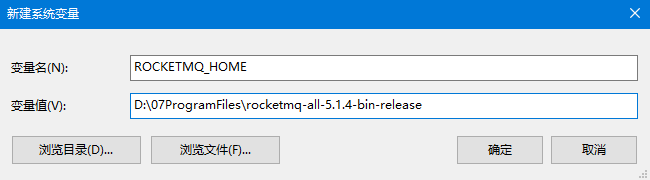
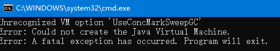
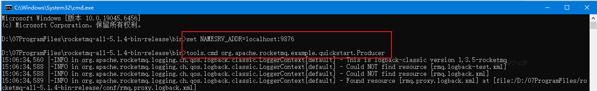
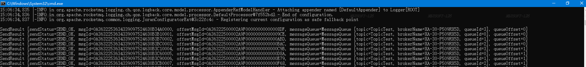
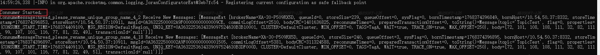

# RocketMQ

> 官方文档：[rocketmq.apache.org](https://rocketmq.apache.org/zh/docs/)  
> 源码：   [github.com/apache/rocketmq](https://github.com/apache/rocketmq)  
> 学习代码：[gitee.com/zhuph/zhuph-learn](https://gitee.com/zhuph/zhuph-learn)（`zhuph-rocketmq`）

RocketMQ 是一款**纯 Java 开发、分布式、高吞吐、高可靠、低延迟**的消息中间件。前身是阿里的 MetaQ，2016 年开源，2017 年成为 Apache 顶级项目，**主打分布式场景**，适配微服务架构。

---

## 一、为什么选择 RocketMQ

### 产生背景

在阿里孕育 RocketMQ 雏形的时期，它被用于异步通信、搜索、社交网络活动流、数据管道、贸易流程。随着贸易业务吞吐上升，原有消息集群（ActiveMQ）的 IO 模块到达瓶颈——节流、断路器、降级都效果不佳；尝试 Kafka 后，其**低延迟和高可靠性**又无法满足交易类场景。于是决定自研新的消息引擎，覆盖从传统 pub/sub 到高容量实时零误差交易系统的全场景。

历经十余年打磨，RocketMQ 已成为业内共识的**金融级可靠业务消息**首选方案。

### 与主流 MQ 对比

| 特性 | RocketMQ | ActiveMQ | Kafka |
| --- | --- | --- | --- |
| 事务消息 | **原生两阶段提交** | XA（重量级） | 不支持 |
| 延迟消息 | **任意精度** | 有限级别 | 不支持 |
| 死信队列 | **内置重试机制** | 内置 | 需手动实现 |
| 消息轨迹 | **内置全链路追踪** | 插件实现 | 不支持 |
| 消息过滤 | **SQL92 + Tag** | 有限支持 | 仅 Topic 级 |
| 消息顺序 | **分区级严格 FIFO** | — | 仅分区级 |
| 水平扩展 | **线性扩展** | 有限 | 受分区数约束 |
| 运维工具 | **Dashboard + CLI** | 基础 Web 控制台 | 依赖第三方 |
| 协议支持 | gRPC/MQTT/AMQP/HTTP | AMQP/STOMP/MQTT | 自定义 TCP |

选型结论：

- **对比 Kafka**：Kafka 主打大数据日志传输、吞吐极高，但企业级特性缺失；RocketMQ 吞吐接近 Kafka，同时补齐事务、延时、死信、顺序消息，运维也更简单
- **对比 RabbitMQ**：RabbitMQ 基于 Erlang，高吞吐场景性能不足、集群扩展麻烦、海量堆积易 OOM；RocketMQ 纯 Java 与业务技术栈一致，百万级堆积无压力

### 核心应用场景

1. **异步解耦**（最核心）：下单后「扣库存、减余额」从同步执行改为发 MQ 消息异步消费，彻底解耦、削峰填谷、提升接口响应速度
2. **流量削峰**：秒杀场景请求暴增，MQ 承接全部请求，消费端按自身能力匀速消费，避免数据库被冲垮
3. **日志归集**：分布式服务日志异步发送到日志服务统一存储分析
4. **最终一致性**：分布式事务场景通过**事务消息**保证跨服务数据最终一致，替代复杂的 2PC
5. **广播通知**：配置更新、缓存刷新等需要所有服务节点消费的场景
6. **延时任务**：基于延时消息实现非精准定时任务，如订单 30 分钟未支付自动关闭

---

## 二、核心概念

理解这几个概念是后面所有操作的基础：

| 概念 | 说明 |
| --- | --- |
| **NameServer** | 轻量级路由节点，集群的**通讯录**，维护 Broker 地址，不存储消息、不参与消息传输 |
| **Broker** | 消息存储与投递的真正载体，分 Master / Slave 角色 |
| **Topic** | 消息的逻辑分类，类似数据库的表 |
| **MessageQueue** | Topic 下的物理队列，**顺序消息的最小单位**，一个 Topic 默认 4 个队列 |
| **Tag** | Topic 下的二级分类，消费端可用 `*` 或表达式过滤 |
| **ProducerGroup** | 生产者组，同组内多个实例保证**事务消息**的分布式锁 |
| **ConsumerGroup** | 消费者组，同组内消息**只被一个实例消费**（集群消费）；各实例都消费则是广播模式 |

::: tip 生产者与消费者组的核心区别
消费者组内是**负载均衡**关系——组内每个消息只被一个消费者处理；而生产者组内是**广播**关系——每个生产者实例发出的消息都要同步给所有 Broker。
:::

### 消息存储结构

```
Topic（逻辑分类）
  └─ MessageQueue（物理队列，4 个默认）
       └─ CommitLog（单个存储文件，所有队列共用）
            └─ ConsumeQueue（逻辑索引，记录消息在 CommitLog 中的位置）
```

RocketMQ 采用**顺序写 + 随机读**设计：消息统一追加写入 CommitLog，消费时先读 ConsumeQueue 拿到物理偏移，再去 CommitLog 定位消息体。这是它高吞吐的根本原因。

---

## 三、安装部署

### 环境要求

- 64 位操作系统，推荐 Linux / Unix / macOS
- **64 位 JDK 1.8+**
- 下载：https://rocketmq.apache.org/download

### Windows

#### 1. 配置环境变量

新增系统环境变量 `ROCKETMQ_HOME`：



同时将 `%ROCKETMQ_HOME%\bin` 加入 `Path`。

#### 2. 启动 NameServer

打开命令提示符，进入 RocketMQ 安装目录的 `bin` 目录：

```shell
start mqnamesrv.cmd
```

::: warning 高版本 JDK 启动报错
用 JDK 11/17/21 启动时会出现如下报错：



**原因**：RocketMQ 的启动脚本（`mqnamesrv` / `mqbroker`）中写死了 CMS 垃圾回收器相关的 JVM 参数：

- `-XX:+UseConcMarkSweepGC`
- `-XX:+UseCMSCompactAtFullCollection`
- `-XX:+PrintGCDateStamps`

这些参数在 **JDK 8 可用，JDK 9 起废弃，JDK 14 起被彻底移除**（CMS 收集器已从 HotSpot 中删除），所以高版本 JDK 无法识别。

**方案一：切换到 JDK 8**（最省事，适合本地开发）

修改系统环境变量 `JAVA_HOME` 指向 JDK 8，或在 `runserver.cmd` / `runbroker.cmd` 中把 `%JAVA_HOME%` 直接替换为 JDK 8 的绝对路径：

```bat
set "JAVA=D:\07ProgramFiles\jdk1.8.0_xxx\bin\java.exe"
```

::: tip 方案二：声明 JDK 主版本号（不改脚本）
在环境变量中新增 `JAVA_MAJOR_VERSION`，值填你的 JDK 主版本号（如 `17`），启动脚本内部会据此判断并跳过 CMS 参数。

**方案三：手动修改脚本参数**
用记事本打开 `bin` 目录下的 `runserver.cmd` 和 `runbroker.cmd`，把上述 CMS 参数**全部删除**，或替换为高版本 JDK 支持的收集器，例如：

```bat
set "JAVA_OPT=%JAVA_OPT% -XX:+UseG1GC"
```

三个方案任选其一，推荐方案二；改动前建议先备份脚本。
:::

#### 3. 启动 Broker

```shell
start mqbroker.cmd -n 127.0.0.1:9876 -c ../conf/broker.conf
```

::: tip 参数说明
- `-n 127.0.0.1:9876`：指定 NameServer 地址
- `-c ../conf/broker.conf`：指定 Broker 配置文件（可选）
- `autoCreateTopicEnable=true`：允许自动创建 Topic，**仅建议本地调试使用**，生产环境应显式创建 Topic
:::

启动成功后不要关闭窗口。日志一般在用户目录下的 `logs/rocketmqlogs/` 中。

### Linux

```shell
# 启动 NameServer
nohup sh bin/mqnamesrv &

# 启动 Broker（5.x 使用 Local 模式，Broker 与 Proxy 同进程）
nohup sh bin/mqbroker -n localhost:9876 --enable-proxy &
```

验证是否启动成功：

```shell
tail -f ~/logs/rocketmqlogs/namesrv.log   # 出现 The Name Server boot success...
tail -f ~/logs/rocketmqlogs/proxy.log     # 出现 The broker[broker-a,ip:port] boot success...
```

停止服务：

```shell
sh bin/mqshutdown broker
sh bin/mqshutdown namesrv
```

### 常用端口

| 端口 | 用途 |
| --- | --- |
| 9876 | NameServer 对外服务端口 |
| 10909 | Broker VIP 通道（主从同步） |
| 10911 | Broker 对外服务端口 |
| 10912 | Broker HA 通道 |
| 8080 / 8081 | Proxy（5.x gRPC 接入点） |

---

## 四、功能验证

RocketMQ 自带收发消息的示例脚本 `tools.cmd`（Linux 为 `tools.sh`），用于验证功能是否正常。

### 启动消费者

打开一个 cmd 窗口，进入 `bin` 目录：

```shell
set NAMESRV_ADDR=localhost:9876
tools.cmd org.apache.rocketmq.example.quickstart.Consumer
```

### 启动生产者

再打开一个 cmd 窗口，进入 `bin` 目录：



```shell
set NAMESRV_ADDR=localhost:9876
tools.cmd org.apache.rocketmq.example.quickstart.Producer
```

生产者会发送 1000 条消息，每条返回 `sendStatus=SEND_OK` 表示发送成功：



与此同时，消费者窗口开始接收消息：



能正常收发消息，说明 RocketMQ 功能正常。

---

## 五、控制台部署

### rocketmq-console 已废弃

从 RocketMQ 4.9.0 起，官方已将 `rocketmq-console` 从 `rocketmq-externals` 仓库移除（https://github.com/apache/rocketmq-externals）。

独立控制台项目已**迁移并重命名为 `rocketmq-dashboard`**：https://github.com/apache/rocketmq-dashboard

::: warning 注意路径变化
旧教程里的 `rocketmq-externals/rocketmq-console/src/main/resources` 在新项目下应为 `rocketmq-dashboard/src/main/resources`，打包产物也从 `rocketmq-console-ng-*.jar` 变成了 `rocketmq-dashboard-*.jar`。
:::

### 部署步骤

**1. 解压并修改配置**

进入 `rocketmq-dashboard/src/main/resources`，编辑 `application.properties`：

```properties
server.port=8080
rocketmq.config.namesrvAddr=127.0.0.1:9876
```

::: tip 端口说明
`server.port` **默认是 8080**。如果与本机已有服务冲突（如 Tomcat、Nacos），改成一个空闲端口即可——注意访问地址要和这里配置的一致。
:::

**2. 打包**

在 `rocketmq-dashboard` 根目录执行：

```shell
mvn clean package -Dmaven.test.skip=true
```

**3. 启动**

```shell
java -jar target/rocketmq-dashboard-1.0.0.jar
```

也可以不改配置文件，直接用启动参数指定：

```shell
java -jar target/rocketmq-dashboard-1.0.0.jar --server.port=8080 --rocketmq.config.namesrvAddr=127.0.0.1:9876
```

### 访问控制台

浏览器打开启动日志中打印的地址（默认 `http://127.0.0.1:8080`），控制台可查看 Topic、消费者组、消息轨迹、集群状态等。

---

## 六、参考资料

- [RocketMQ 官方文档](https://rocketmq.apache.org/zh/docs/)
- [RocketMQ 快速开始（官方）](https://rocketmq.apache.org/zh/docs/quickStart/01quickstart/)
- [rocketmq-dashboard 仓库](https://github.com/apache/rocketmq-dashboard)
- [Windows 环境下 RocketMQ 的安装及配置（图文详解）](https://blog.csdn.net/weixin_43978412/article/details/113880980)
- [Unrecognized VM option 'UseConcMarkSweepGC' 问题解决](https://juejin.cn/post/7207042977385709605)
