# Redis 学习笔记

## 1. Redis入门

### 1.1 简介

Redis 全称 **REmote DIctionary Server**（远程字典服务），是一个完全开源的、高性能的 Key-Value 数据库。是一个基于**内存**的 key-value 结构数据库，使用 C 语言开发、开源、高性能，官方数据可达 100000+ QPS（每秒查询次数），是互联网技术领域应用最广泛的**存储中间件**。它存储的 value 类型比较丰富，也被称为结构化的 NoSql 数据库。

**官网：** https://redis.io

**中文网：** https://www.redis.net.cn/

**key-value 结构存储：**


**主要特点：**

- 基于内存存储，读写性能高
- 适合存储热点数据（热点商品、资讯、新闻）
- 企业应用广泛

NoSql（Not Only SQL），不仅仅是 SQL，泛指**非关系型数据库**。NoSql 数据库并不是要取代关系型数据库，而是关系型数据库的补充。

**关系型数据库(RDBMS)：**

- Mysql
- Oracle
- DB2
- SQLServer

**非关系型数据库(NoSql)：**

- Redis
- Mongo db
- MemCached

**深入理解**

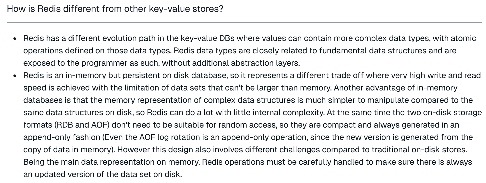

**核心总结：**

- **数据结构复杂**：相比传统 K-V 型数据库，Redis 能够支撑更复杂的数据类型，已经远远超出了缓存的范围，可以实现很多复杂的业务场景，并且还在不断发展更多的业务场景；
- **数据保存在内存，但是持久化到硬盘**：数据全部保存在内存，读写性能非常高，是集中式缓存的不二之选；数据又持久化到硬盘，意味着 Redis 上保存的数据非常安全，目前完全可以当做一个数据库来用。

所以，官方对 Redis 的作用已经定位成三个方面：**Cache（缓存）**、**Database（数据库）**、**Vector Search（向量搜索）**。


### 1.2 客户端连接

**redis-cli.exe**

 

通过redis-cli.exe命令默认连接的是本地的redis服务，并且使用默认6379端口。也可以通过指定如下参数连接：

- -h ip地址
- -p 端口号
- -a 密码（如果需要）

设置Redis服务密码，修改redis.windows.conf

```
requirepass 123456
```

**注意：**

- 修改密码后需要重启Redis服务才能生效
- Redis配置文件中 # 表示注释

重启Redis后，再次连接Redis时，需加上密码，否则连接失败。

```
redis-cli.exe -h localhost -p 6379 -a 123456
```

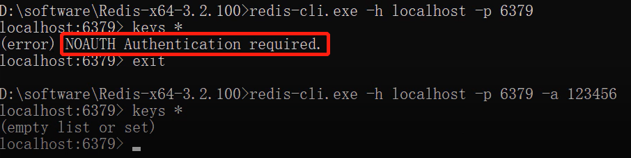 

此时，-h 和 -p 参数可省略不写。

### 1.3 图形工具

默认提供的客户端连接工具界面不太友好，同时操作也较为麻烦，接下来，引入一个Redis客户端图形工具。

 

**新建连接**

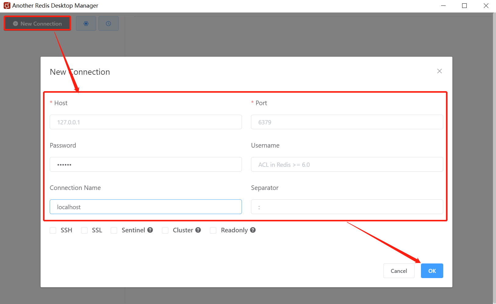  

**连接成功** 

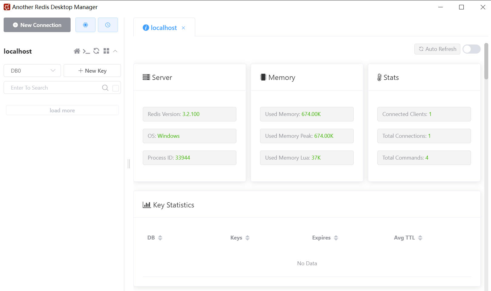  

### 1.4 Redis 生态：2024 年的 Redis

在 2023 年之前，Redis 是一个纯粹的开源数据库；近两年 Redis 正在进行华丽的蜕变，从一个缓存产品变成一整套生态服务。

**产品与服务体系：**

| 产品 | 说明 |
| --- | --- |
| Redis OSS | 传统开源服务体系（以前常用的开源体系） |
| Redis Stack | 基于 Redis OSS 打造的更完整技术栈，在 OSS 功能基础上提供高级扩展功能 |
| Redis Cloud | 云服务，基于 AWS、Azure 等公有云，提供一整套完整的企业服务 |
| Redis Enterprise | 企业级收费产品服务 |
| Redis Insight | Redis 官方推出的安装管理套件 / 图形化客户端 |

**要点：**

- **Redis Insight**：官方图形化客户端，以往使用 Redis 需要寻找各种第三方客户端，现在开箱即用；并且 Redis Insight 也可以在 Redis Cloud 上直接使用；
- 功能层面目前形成了 **Redis OSS** 与 **Redis Stack** 两套服务体系：OSS 是传统开源体系，Stack 基于 OSS 打造、提供更高级的扩展功能（基于 Redis Cloud 提供服务）。

## 2. Redis部署

**四种部署方式对比：**

| 部署方式 | 节点组成 | 自动故障转移 | 数据分片 | 主要作用 | 适用场景 |
| --- | --- | --- | --- | --- | --- |
| 单机部署 | 1 个节点 | ❌ | ❌ | 快速上手 | 开发测试、小规模应用 |
| 主从部署 | 1 主 + N 从 | ❌ 需人工切换 | ❌ | 数据冗余、读扩展 | 读写分离 |
| 哨兵部署 | 1 主 + N 从 + 哨兵集群 | ✅ | ❌ | 自动故障转移 | 生产高可用 |
| 集群部署 | N 主 + N 从 | ✅ | ✅ 16384 个哈希槽 | 分片 + 高可用 | 大数据量、高并发 |

### 2.1 Windows

#### 2.1.1 Redis 下载

Redis安装包分为windows版和Linux版：

- Windows版下载地址：https://github.com/microsoftarchive/redis/releases
- Linux版下载地址： https://download.redis.io/releases/

#### 2.1.2 Redis 安装

**1）在Windows中安装Redis**

Redis的Windows版属于绿色软件，直接解压即可使用，解压后目录结构如下：

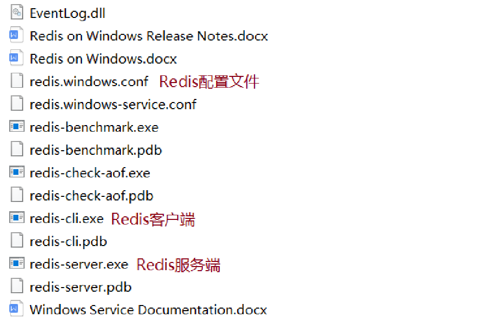 

**windows后台启动redis操作步骤**

1. 下载安装redis
官网下载，解压即安装

2. 安装redis服务到任务管理器【执行完该步骤，检查任务管理器服务一栏，会出现redis服务】

redis-server --service-install redis.windows.conf --loglevel verbose

3. 启动服务【可以打开任务管理器的服务，找到redis手动开启】
redis-server --service-start

4. 停止服务【可以打开任务管理器的服务，找到redis手动关闭】
redis-server --service-stop

#### 2.1.3 Redis 服务启动与停止

**redis-server.exe redis.windows.conf**

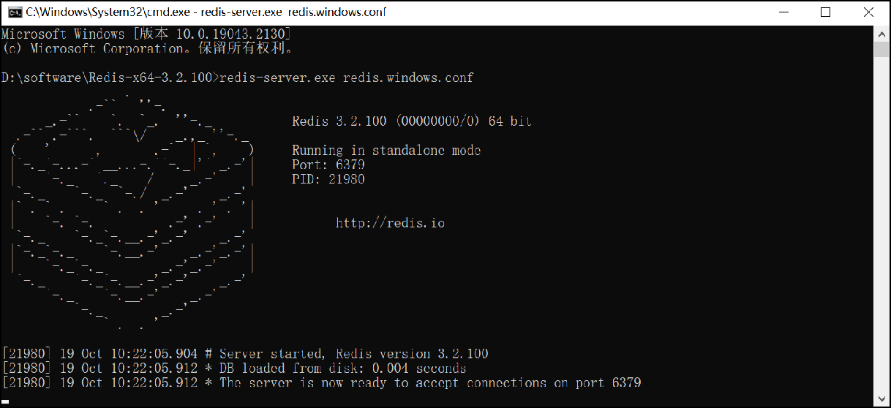 

Redis服务默认端口号为 **6379** ，通过快捷键**Ctrl + C** 即可停止Redis服务

当Redis服务启动成功后，可通过客户端进行连接。

### 2.2 单机

#### 2.2.1 检查安装 gcc 环境

Redis 由 C 语言编写，运行需要 C 环境，因此需要先安装 gcc。

```shell
# 关闭防火墙
systemctl stop firewalld.service
# 查看防火墙状态
firewall-cmd --state
# 卸载防火墙（可选）
yum remove firewalld
# 检查 gcc 版本
gcc --version
# 安装 gcc
yum install gcc
```

#### 2.2.2 下载安装 Redis

```shell
# 安装应用养成良好习惯，文件归类
mkdir -p /opt/software/redis
# 进入 redis 文件夹，使用 wget 下载
cd /opt/software/redis
wget https://download.redis.io/redis-stable.tar.gz
# 解压下载的 redis 包
tar -xzf redis-stable.tar.gz
# 进入 redis-stable 目录，使用 make install 编译并安装
# 安装完成后 /usr/local/bin 会生成相应的服务
cd redis-stable
make install
# 检查是否成功生成
ll /usr/local/bin
```

安装后 `/usr/local/bin` 下生成的文件：

| 文件 | 说明 |
| --- | --- |
| redis-benchmark | 性能测试工具 |
| redis-check-aof | 修复有问题的 AOF 文件 |
| redis-check-rdb | 修复有问题的 RDB 文件 |
| redis-sentinel | 哨兵（集群/高可用使用） |
| redis-server | Redis 服务器启动命令 |
| redis-cli | 客户端，操作入口 |

#### 2.2.3 启动 Redis

```shell
# Redis 源码路径下启动
./src/redis-server
# 使用 /usr/local/bin 路径下启动（该目录下）
redis-server
```

> **注意：直接启动无法后台运行。** 上面的启动方式无法在后台运行，退出之后直接关闭了 Redis 服务，所以还需要针对 Redis 做一些设置。

#### 2.2.4 配置 Redis

```shell
# 修改当前 Redis 目录下的 redis.conf 文件（vim 打开后没有行号可输入 ":set number"）
vim redis.conf
```

需要修改的内容（行号对应 Redis 7.2.5 默认配置）：

| 配置项 | 设置值 | 行号 | 说明 |
| --- | --- | --- | --- |
| `bind` | `* -:::*` | 87 | 修改 bind 项，支持远程连接 |
| `daemonize` | `yes` | 309 | 开启守护进程，后台运行 |
| `logfile` | `/opt/software/redis/redis-stable/redis.log` | 355 | 指定日志文件目录 |
| `dir` | `/opt/software/redis` | 510 | 指定工作目录 |
| `requirepass` | `1qaz@WSX` | 1044 | 给默认用户设置密码（redis-cli 连接时需密码校验，自行学习可不设置） |
| `protected-mode` | `no` | 111 | 允许远程连接；**如果不设置密码必须将此设置关闭** |

修改完成后，使用配置文件启动 Redis，并用 redis-cli 连接测试。由于配置了安全密码，连接后需要先验证密码，否则报错：

```shell
redis-server redis.conf
redis-cli
auth 1qaz@WSX
```

#### 2.2.5 退出或关闭 Redis

```shell
# 退出 redis（仅退出客户端）
quit
# 关闭 redis 服务
redis-cli shutdown
```

### 2.3 主从Master-Slave

主从复制，是指将一台 Redis 服务器的数据，复制到其他的 Redis 服务器。前者称为**主节点（Master）**，后者称为**从节点（Slave）**；数据的复制是**单向**的，只能由主节点到从节点。默认情况下，每台 Redis 服务器都是主节点；一个主节点可以有多个从节点（或没有从节点），但一个从节点只能有一个主节点。

**整体架构（1 主 2 从）：**

```text
           客户端
    读/写 ↓        ↓ 读
   ┌───────────┐
   │  主节点    │ 192.168.75.129:6379
   │ (Master)  │
   └───────────┘
  同步 ↓       ↓ 同步
┌─────────┐ ┌─────────┐
│ 从节点   │ │ 从节点   │
│ .131:6379│ │ .132:6379│
└─────────┘ └─────────┘
```

#### 2.3.1 主从复制的作用

- **a）数据冗余**：主从复制实现了数据的热备份，是持久化之外的一种数据冗余方式。
- **b）故障恢复**：当主节点出现问题时，可以由从节点提供服务，实现快速的故障恢复；实际上是一种服务的冗余。
- **c）负载均衡**：在主从复制的基础上配合读写分离，主节点提供写服务、从节点提供读服务（写 Redis 时应用连接主节点，读 Redis 时应用连接从节点），分担服务器负载；尤其是在写少读多的场景下，通过多个从节点分担读负载，可以大大提高 Redis 服务器的并发量。
- **d）高可用基石**：主从复制还是哨兵和集群能够实施的基础，因此说主从复制是 Redis 高可用的基础。

#### 2.3.2 主从复制部署

主节点不需要做任何改变，从节点都需要修改配置加上主节点信息：

```shell
# 从节点 redis.conf 中添加主节点信息
replicaof 192.168.75.129 6379
```

配置完成后，在主库检查从节点信息：

```
127.0.0.1:6379> info Replication
# Replication
role:master
connected_slaves:2
slave0:ip=192.168.75.131,port=6379,state=online,offset=270,lag=1
slave1:ip=192.168.75.132,port=6379,state=online,offset=270,lag=1
...
```

#### 2.3.3 主从复制的缺点

- **复制延时、信号衰减**：所有的写操作都是先在 master 上操作，然后同步更新到 slave 上，从 master 同步到 slave 机器上有一定的延迟；系统繁忙时延迟问题更严重，slave 机器数量增加也会加剧该问题。
- **master 挂了怎么办**：默认情况下，不会在 slave 节点中自动重选一个 master，每次都要人工干预。

### 2.4 哨兵Sentinel

Redis 的主从复制主要用于实现数据的冗余备份和读分担，并不是为了提供高可用性。因此在系统高可用方面，单纯的主从架构无法很好的保证整个系统高可用。

#### 2.4.1 哨兵模式的原理

Redis 哨兵模式是通过在独立的哨兵节点上运行特定的哨兵进程来实现的。这些哨兵进程监控主从节点的状态，并在发现故障时自动完成故障发现和转移，并通知应用方，实现高可用性。

**架构示意：**

```text
        客户端 / 应用方
              ↑ 通知新主节点
      ┌─────────────────┐
      │ 哨兵集群 Sentinel×3 │（奇数个）
      └─────────────────┘
    监控 ↓           ↓ 监控
  ┌──────────┐   ┌──────────┐
  │ 主节点    │   │ 从节点 ×N │
  │ .129:6379│   └──────────┘
  └──────────┘
```

#### Sentinel核心配置

Redis的服务端口为6379(master),6380,6381。Sentinel的服务端口为26379,26380,26381

Sentinel最核心的配置其实就是 sentinel.conf中的

`sentinel monitor <master-name> <ip> <redis-port> <quorum>`

```
# sentinel monitor <master-name> <ip> <redis-port> <quorum>
#
# Tells Sentinel to monitor this master, and to consider it in O_DOWN
# (Objectively Down) state only if at least <quorum> sentinels agree.
#
# Note that whatever is the ODOWN quorum, a Sentinel will require to
# be elected by the majority of the known Sentinels in order to
# start a failover, so no failover can be performed in minority.
#
# Replicas are auto-discovered, so you don't need to specify replicas in
# any way. Sentinel itself will rewrite this configuration file adding
# the replicas using additional configuration options.
# Also note that the configuration file is rewritten when a
# replica is promoted to master.
#
# Note: master name should not include special characters or spaces.
# The valid charset is A-z 0-9 and the three characters ".-_".
sentinel monitor mymaster 127.0.0.1 6379 2
```

#### 2.4.2 哨兵工作流程

- **领导者选举**：启动时每个哨兵节点执行选举过程，其中一个哨兵节点被选为领导者（leader），负责协调其他哨兵节点。
  - 选举过程：每个在线的哨兵节点都可以成为领导者，向其它哨兵发 `is-master-down-by-addr` 命令，征求判断并要求将自己设置为领导者；其它哨兵可同意或拒绝；若票数 `>= num(sentinels)/2 + 1` 则成为领导者，否则继续选举。
- **监控主从节点**：哨兵节点通过发送命令周期性地检查主从节点的健康状态（主节点是否在线、从节点是否同步等）。发现主节点不可用，触发一次故障转移。
- **故障转移**：主节点被判定不可用后，哨兵会从当前从节点中选出一个新的主节点，并将其他从节点切换到新的主节点，系统继续提供服务而无需人工介入。
- **故障检测**：sentinel 向 master 发送心跳 PING 确认是否存活，若 master 在"一定时间范围"内不回应 PONG 或回复错误消息，该 sentinel 主观（单方面）认为 master 已不可用。
- **从节点筛选**：过滤掉不健康的（下线或断线）、没有回复过哨兵 ping 响应的从节点；选择从节点优先级最高的；选择复制偏移量最大（复制最完整）的从节点。当主节点出现故障，由领导者负责处理故障转移。
- **客户端重定向**：哨兵节点会通知客户端新的主节点的位置，使其能够与新的主节点建立连接并发送请求，确保客户端无缝切换。
- **从节点监控**：从节点出现故障时哨兵可将其下线，恢复正常后重新将其加入集群。

#### 2.4.3 客观下线

当主观下线的节点是主节点时，该哨兵节点会通过指令 `sentinel is-master-down-by-addr` 寻求其它哨兵节点对主节点的判断，当超过 **quorum（选举）个数**时，哨兵节点认为该主节点确实有问题，即**客观下线**（大部分哨兵节点都同意下线操作）。

#### 2.4.4 哨兵模式部署

**架构：** 3 台机器（`192.168.75.129/131/132`），每台各部署 1 个哨兵（端口 `26379`），监控主节点 `192.168.75.129:6379`。

主从配置无需修改，3 个机器都需要修改 `sentinel.conf` 配置，配置完成之后先从主节点开始启动哨兵，3 个机器配置相同：

```shell
# sentinel.conf 需要修改的内容（行号对应 Redis 7.2.5 默认配置）
protected-mode no                                # 第6行，关闭保护模式
daemonize yes                                    # 第15行，指定 sentinel 为后台启动
logfile /opt/software/redis/redis-stable/sentinel.log   # 第34行，指定日志存放路径
dir /opt/software/redis                          # 第73行，指定数据库存放路径
sentinel monitor mymaster 192.168.75.129 6379 2  # 第93行，监控主节点；mymaster 为主节点名称；最后的 2 表示至少需要 2 个哨兵节点同意才能判定主节点故障并进行故障转移
sentinel down-after-milliseconds mymaster 30000  # 第134行，判定服务器 down 掉的时间周期，默认 30000 毫秒（30 秒）
sentinel failover-timeout mymaster 180000        # 第234行，故障节点的最大超时时间为 180000（180 秒）
```

启动

```
[root@192-168-65-214 sentinel]# redis-sentinel ./sentinel26379.conf
[root@192-168-65-214 sentinel]# redis-sentinel ./sentinel26380.conf
[root@192-168-65-214 sentinel]# redis-sentinel ./sentinel26381.conf

[root@192-168-65-214 sentinel]# ps -ef|grep redis
root      4849     1  0 21:14 ?        00:00:02 redis-server *:6380
root      4859     1  0 21:14 ?        00:00:02 redis-server *:6381
root      5166     1  0 21:32 ?        00:00:00 redis-server *:6379
root      5239     1  0 21:38 ?        00:00:00 redis-sentinel *:26379 [sentinel]
root      5259     1  0 21:38 ?        00:00:00 redis-sentinel *:26380 [sentinel]
root      5265     1  0 21:38 ?        00:00:00 redis-sentinel *:26381 [sentinel]
root      5271 31762  0 21:38 pts/0    00:00:00 grep --color=auto redis
```

启动后检查哨兵状态：

```shell
redis-cli -p 26379 info sentinel
# master0:name=mymaster,status=ok,address=192.168.75.129:6379,slaves=2,sentinels=3
```

#### 2.4.5 故障转移演练

```shell
# 故障模拟：可以杀掉主节点的进程，也可以直接停掉主节点服务
ps aux | grep redis
redis-cli shutdown
redis-cli -a zhuph -p 6379 shutdown

# 观察哨兵日志，129 主节点下线，重新选举 131 为主节点
tail -f sentinel.log

# 重新启动 129 服务并观察日志，129 加入主从，此时主节点为 131 服务
redis-server redis.conf
tail -f sentinel.log
redis-cli -p 26379 info sentinel

# 停止哨兵
redis-cli -p 26379 shutdown
```

哨兵日志关键行（故障转移过程）：

```text
+sdown master mymaster 192.168.75.129 6379             # 主观下线
+new-epoch 4                                            # 新一轮选举
+vote-for-leader a04107c0b37ab2b32d852cd1d719a57f1a7b89877 4   # 投票选举领导者
+odown master mymaster 192.168.75.129 6379 quorum 3/2  # 客观下线
+switch-master mymaster 192.168.75.129 6379 192.168.75.131 6379  # 131 为新主节点
```

触发哨兵选举之后，会在后台更改 `redis.conf` 与 `sentinel.conf`（文件末尾追加 `# Generated by CONFIG REWRITE` 生成的内容，如 `replicaof 192.168.75.131 6379`），可以检查每台机器的文件末尾数据。

#### 2.4.6 哨兵使用建议与局限

**哨兵使用建议：**

- 哨兵节点的数量应为多个，哨兵本身应该集群，保证高可用
- 哨兵节点数应该是**奇数**
- 各个哨兵结点的配置应一致
- 如果哨兵节点部署在 Docker 等容器里面，尤其要注意端口号的正确映射

**哨兵模式并不能保证数据零丢失：**

1. **复制延迟**：从节点的数据是异步复制自主节点的，主节点故障时从节点可能还没完全同步最新数据，从而导致数据丢失。
2. **故障检测和转移时间**：Sentinel 检测到主节点故障并执行故障转移需要一定时间，期间主节点可能已接收一些写操作，但这些操作尚未被复制到从节点。
3. **网络分区**：发生网络分区（网络分裂）时，一部分节点可能与主节点失去联系；若此时主节点继续处理写操作，网络恢复之前这些操作可能不会被复制到从节点。
4. **多个从节点同时故障**：所有从节点同时故障或在故障转移之前与主节点失联时，主节点故障时将没有可用的从节点来提升为主节点。

### 2.5 集群Cluster

Redis 集群是 Redis 的一种**分布式运行模式**，通过分片（sharding）提供数据的自动分区和管理，实现数据的高可用性和可扩展性。

- 集群模式下，数据被分割成多个部分（称为**槽或 slots**），分布在多个 Redis 节点上；
- 集群中的节点分为主节点和从节点：**主节点**负责读写请求和集群信息的维护；**从节点**只进行主节点数据和状态信息的复制。

#### 2.5.1 Redis 集群的作用

- **数据分区（数据分片）**：集群最核心的功能。数据分散到多个节点，一方面突破了 Redis 单机内存大小的限制，存储容量大大增加；另一方面每个主节点都可以对外提供读服务和写服务，大大提高了集群的响应能力。
  - 单机内存过大还会带来其他问题：bgsave 和 bgrewriteaof 的 fork 操作可能导致主进程阻塞；主从环境下主机切换时可能导致从节点长时间无法提供服务；全量复制阶段主节点的复制缓冲区可能溢出。
- **高可用**：集群支持主从复制和主节点的自动故障转移（与哨兵类似）；当任一节点发生故障时，集群仍然可以对外提供服务。

#### 2.5.2 数据分片（哈希槽）

Redis 集群引入了**哈希槽**的概念：

- Redis 集群有 **16384 个哈希槽**（编号 0-16383）；
- 集群的每个节点负责一部分哈希槽；
- 每个 Key 通过 **CRC16 校验后对 16384 取余**来决定放置哪个哈希槽，再根据这个值找到对应的节点，自动跳转到该节点上进行存取操作。

以 3 个节点组成的集群为例：

| 节点 | 负责的哈希槽范围 |
| --- | --- |
| 节点 A | 0 - 5460 |
| 节点 B | 5461 - 10922 |
| 节点 C | 10923 - 16383 |

**主从复制模型：** 集群中具有 A、B、C 三个节点，如果节点 B 失败，整个集群会因缺少 5461-10922 这个范围的槽而不可用；为每个节点添加从节点 A1、B1、C1 后（三主三从），B 失败时集群选举 B1 为新的主节点继续服务；当 B 和 B1 都失败后，集群将不可用。

#### 2.5.3 集群部署

**集群环境：** 三主三从模式，3 台机器各部署 2 个 Redis 节点：`6379`（主）+ `6380`（从）。

```shell
# 创建集群配置文件夹，将下面的配置复制过去（另外两个机器重复这个过程）
mkdir -p /opt/software/redis/redis-stable/cluster
mkdir -p /opt/software/redis/cluster
vim ./cluster/redis_6379.conf
vim ./cluster/redis_6380.conf
```

**6379 配置（redis_6379.conf）：**

```shell
# 允许所有的IP地址
bind * -::*
# 后台运行
daemonize yes
# 允许远程连接
protected-mode no
# 开启集群模式
cluster-enabled yes
# 集群节点超时时间
cluster-node-timeout 5000
# 配置数据存储目录
dir "/opt/software/redis/cluster"
# 开启AOF持久化
appendonly yes
# 端口
port 6379
# log日志
logfile "/opt/software/redis/redis-stable/cluster/redis6379.log"
# 集群配置文件
cluster-config-file nodes-6379.conf
# AOF文件名
appendfilename "appendonly6379.aof"
# RDB文件名
dbfilename "dump6379.rdb"
```

**6380 配置（redis_6380.conf）：** 与 6379 相同，仅修改：`port 6380`、`logfile ".../redis6380.log"`、`cluster-config-file nodes-6380.conf`、`appendfilename "appendonly6380.aof"`、`dbfilename "dump6380.rdb"`。

```shell
# 配置文件准备完成之后，启动所有 redis 服务（用 cluster 配置文件）
redis-server ./cluster/redis_6379.conf
redis-server ./cluster/redis_6380.conf
# 检查服务
ps aux | grep redis

# 创建三主三从集群模式，每一个主节点带一个从节点
redis-cli --cluster create --cluster-replicas 1 \
  192.168.75.129:6379 192.168.75.129:6380 \
  192.168.75.131:6379 192.168.75.131:6380 \
  192.168.75.132:6379 192.168.75.132:6380

# 查看集群信息
redis-cli cluster info
# 查看单个节点信息
redis-cli info replication
# 查看集群节点身份信息
redis-cli cluster nodes
```

集群创建成功后的槽位分配与主从分布（关键输出）：

```text
>>> Performing hash slots allocation on 6 nodes...
Master[0] -> Slots 0 - 5460
Master[1] -> Slots 5461 - 10922
Master[2] -> Slots 10923 - 16383
Adding replica 192.168.75.131:6380 to 192.168.75.129:6379
...
Can I set the above configuration? (type 'yes' to accept): yes
>>> Nodes configuration updated
>>> Sending CLUSTER MEET messages to join the cluster
Waiting for the cluster to join
```

#### 2.5.4 集群数据读写

```shell
# 连接任意一个主节点（不加 -c 时，key 不在当前节点的槽位会报 MOVED）
redis-cli -h 192.168.75.129 -p 6379
```

直接连接读写可能会报 `MOVED` 错误——因为不同节点的槽位不同，提示去对应节点写入：

```
127.0.0.1:6379> set k1 v1
(error) MOVED 12706 192.168.75.132:6379
127.0.0.1:6379> set k2 v2
OK
```

开启路由规则 `-c` 后，重新写入数据恢复正常（自动跳转到槽位所在节点）：

```shell
redis-cli -c
# -> Redirected to slot [12706] located at 192.168.75.132:6379
set k1 b1
OK
```

#### 2.5.5 模拟故障转移

```shell
# 注意机器 ip 的区分
# 将 129 机器的主节点干掉（129 的 6379 服务）
redis-cli -p 6379 shutdown
# 查看 129 机器从节点工作日志（131 的 6380 日志）
cat redis6380.log
# 切换到 132 机器查看当前集群节点信息，131:6380 已经升为主节点
redis-cli cluster nodes
# 重新启动 129.6379 服务
redis-server ./cluster/redis_6379.conf
# 查看 129.6379 的节点信息，主节点变为从节点
redis-cli -p 6379 info replication
# 观察 131.6380 日志，129.6379 重新加入集群
```

**停止集群服务：**

```shell
redis-cli -p 6379 shutdown
redis-cli -p 6380 shutdown
```

### 2.6 文件目录与配置

**文件目录：**

| 目录 | 说明 |
| --- | --- |
| `/opt/software/redis/` | Redis 应用 |
| `/opt/software/redis/redis-stable` | Redis 应用根目录（源码解压目录） |
| `/opt/software/redis/cluster` | Redis 集群应用文件目录（日志、快照等信息） |
| `/opt/software/redis/redis-stable/cluster` | Redis 集群配置文件存放路径 |

**各部署方式的配置文件：**

| 部署方式 | 配置文件 | 所在目录 |
| --- | --- | --- |
| 单机 | `redis.conf` | `/opt/software/redis/redis-stable` |
| 主从 | `redis.conf`（从节点额外加 `replicaof`） | `/opt/software/redis/redis-stable` |
| 哨兵 | `sentinel.conf` | `/opt/software/redis/redis-stable` |
| 集群 | `cluster/redis_6379.conf`、`cluster/redis_6380.conf` | `/opt/software/redis/redis-stable/cluster` |

## 3. Redis 数据类型

> 完整命令列表参考官方文档：https://redis.io/docs/latest/commands/

### 3.1 总览

Redis 存储的是 key-value 结构的数据，其中 key 是字符串类型，value 分为 5 种常用数据类型和 4 种扩展数据类型。

**常用数据类型：**

- 字符串 string
- 哈希 hash
- 列表 list
- 集合 set
- 有序集合 sorted set / zset

**扩展数据类型：**

- 位图 bitmap（基于 String，按位标记 0/1）
- 基数统计 HyperLogLog（基于 String，概率型去重计数）
- 地理位置 Geo（底层 ZSet，存储经纬度）
- 消息流 stream（Redis 5.0 引入，消息队列）

**数据类型一览：**

| 类型 | 底层实现 | 特点 | 典型场景 | 类似 Java 结构 |
| --- | --- | --- | --- | --- |
| string | 动态字符串 SDS | 最基础类型，可存文本/数字/二进制 | 缓存、计数器、分布式锁 | String |
| hash | 哈希表（小数据量用压缩列表） | field-value 映射 | 对象缓存 | HashMap |
| list | 快速列表 quicklist | 有序、可重复，双端操作 | 消息队列、列表 | LinkedList |
| set | 哈希表（全整数小集合用整数集合） | 无序、不重复 | 标签、点赞、共同关注 | HashSet |
| zset | 跳表 + 哈希表（小数据量用压缩列表） | 不重复、带 score 排序 | 排行榜 | TreeMap + 跳表 |
| bitmap | 基于 String | 按位存 0/1，极省内存 | 签到、在线状态、布隆过滤器 | BitSet |
| HyperLogLog | 基于 String | 概率型基数统计，误差约 0.81%，固定约 12KB | UV 统计 | — |
| Geo | 基于 ZSet | geohash 编码存经纬度 | 附近的人/商家、距离计算 | — |
| stream | radix tree（基数树） | 消息流，支持消费者组、ACK | 消息队列 | — |

### 3.2 string 字符串

Redis 中字符串类型常用命令：

- **SET** key value                               设置指定key的值
- **GET** key                                     获取指定key的值
- **SETEX** key seconds value              设置指定key的值，并将 key 的过期时间设为 seconds 秒
- **SETNX** key value                         只有在 key 不存在时设置 key 的值
- **MSET** key value [key value ...]        批量设置多个字符串键值对
- **MGET** key [key ...]                      批量获取多个字符串键值
- **APPEND** key value                       向 key 对应的 value 末尾追加字符串
- **STRLEN** key                                获取字符串长度
- **INCR** key                                    将 key 中存储的数字值加 1（原子操作）
- **DECR** key                                    将 key 中存储的数字值减 1（原子操作）
- **INCRBY** key increment                  将 key 中存储的数字值加上增量 increment
- **DECRBY** key decrement                 将 key 中存储的数字值减去增量 decrement

更多命令可以参考Redis中文网：https://www.redis.net.cn

**命令示例：**

```shell
> set name zhangsan
OK
> get name
zhangsan
> mset name lisi age 18        # 批量存储
OK
> mget name age                # 批量获取
lisi
18
> setex code 60 1234           # 设置值并指定 60 秒过期
OK
> setnx name wangwu            # name 已存在，设置失败返回 0
0
> append name " hello"         # 追加字符串，返回新字符串长度
10
> strlen name
10
> incr counter                 # 计数器自增
1
> incrby counter 10
11
> decr counter
10
```

> 原子加减常用在点赞数、库存、访问量等计数场景：`INCR` 系列命令是原子的，在高并发下不会出现数据错乱。

### 3.3 hash 哈希

Redis hash 是一个string类型的 field 和 value 的映射表，hash特别适合用于存储对象，常用命令：

- **HSET** key field value                    将哈希表 key 中的字段 field 的值设为 value
- **HSETNX** key field value               只有在字段 field 不存在时设置值
- **HGET** key field                          获取存储在哈希表中指定字段的值
- **HMSET** key field value [field value ...]   在一个哈希表 key 中存储多个键值对
- **HMGET** key field [field ...]          批量获取哈希表 key 中多个 field 的值
- **HDEL** key field [field ...]            删除存储在哈希表中的指定字段
- **HLEN** key                                   返回哈希表 key 中字段的数量
- **HKEYS** key                                 获取哈希表中所有字段
- **HVALS** key                                 获取哈希表中所有值
- **HGETALL** key                              获取哈希表 key 中所有的字段和值
- **HINCRBY** key field increment       为哈希表 key 中字段 field 的值加上增量 increment

 

**命令示例：**

```shell
> hset user name zhangsan
1
> hset user age 18
1
> hget user name
zhangsan
> hmset user phone 13800000000 email zs@qq.com
OK
> hmget user name age phone
zhangsan
18
13800000000
> hgetall user
name
zhangsan
age
18
phone
13800000000
email
zs@qq.com
> hlen user
4
> hincrby user age 1             # 年龄 +1
19
> hkeys user
name
age
phone
email
> hdel user email
1
```

> 对象缓存场景：`HSET user:1001 name roy balance 1888`，一个 key 存一个对象的多个字段，比用 String 拼 JSON 更省内存、读写更高效。

### 3.4 list 列表

Redis 列表是简单的字符串列表，按照插入顺序排序，常用命令：

- **LPUSH** key value [value ...]       将一个或多个值插入到列表头部（左端）
- **RPUSH** key value [value ...]       将一个或多个值插入到列表尾部（右端）
- **LPOP** key                               移除并获取列表第一个元素
- **RPOP** key                               移除并获取列表最后一个元素
- **LRANGE** key start stop              获取列表指定范围内的元素（0 ~ -1 表示全部）
- **LINDEX** key index                       通过索引获取列表中的元素
- **LLEN** key                                获取列表长度
- **BLPOP** key [key ...] timeout      移出并获取列表的第一个元素，列表为空时阻塞等待 timeout 秒（timeout=0 一直阻塞）
- **BRPOP** key [key ...] timeout      移出并获取列表的最后一个元素，列表为空时阻塞等待 timeout 秒

 

**命令示例：**

```shell
> lpush list01 a b c d           # 依次从左端插入，最终顺序 d c b a
4
> rpush list01 e f               # 从右端插入
6
> lrange list01 0 -1             # 查看全部元素
d
c
b
a
e
f
> lpop list01                    # 弹出左端元素
d
> rpop list01                    # 弹出右端元素
f
> llen list01
4
> lindex list01 0
c
> lrange list01 0 -1
c
b
a
e
```

> 组合玩法：栈（Stack）= LPUSH + LPOP；队列（Queue）= LPUSH + RPOP；阻塞队列（Blocking MQ）= LPUSH + BRPOP。常见应用：视频列表、签到列表、排队叫号、简化版消息队列。

### 3.5 set 集合

Redis set 是string类型的无序集合。集合成员是唯一的，这就意味着集合中不能出现重复的数据，常用命令：

- **SADD** key member [member ...]     向集合添加一个或多个成员（重复成员自动忽略）
- **SREM** key member [member ...]     移除集合中一个或多个成员
- **SMEMBERS** key                         返回集合中的所有成员
- **SCARD** key                              获取集合的成员数
- **SISMEMBER** key member              判断 member 是否存在于集合中
- **SRANDMEMBER** key [count]          从集合中随机选出 count 个成员（不删除）
- **SPOP** key [count]                       从集合中随机弹出 count 个成员（删除）
- **SINTER** key [key ...]                    返回所有给定集合的交集
- **SUNION** key [key ...]                   返回所有给定集合的并集
- **SDIFF** key [key ...]                      返回第一个集合与其他集合的差集

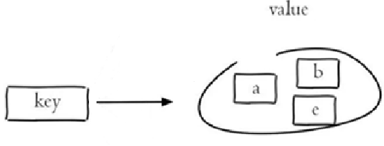 

**命令示例：**

```shell
> sadd like:1001 u001 u002 u003    # 点赞集合
3
> sadd like:1001 u001              # 重复成员忽略，返回 0
0
> scard like:1001                  # 点赞人数
3
> sismember like:1001 u001         # 是否点过赞
1
> smembers like:1001
u001
u002
u003
> sadd A a b c
3
> sadd B b c d
3
> sinter A B                       # 交集 → 共同关注
b
c
> sunion A B                       # 并集 → 朋友圈的人
a
b
c
d
> sdiff A B                        # 差集 → 推荐好友（A 有而 B 没有）
a
```

> 典型应用：微信抽奖（SADD 参与 + SRANDMEMBER/SPOP 抽奖）、点赞/收藏/标签（SADD/SREM/SISMEMBER/SCARD）、社交关系（SINTER 共同关注、SDIFF 推荐好友）。

### 3.6 zset 有序集合

Redis有序集合是string类型元素的集合，且不允许有重复成员。每个元素都会关联一个double类型的分数，集合根据分数升序排序。常用命令：

- **ZADD** key score member [score member ...]    向有序集合添加一个或多个成员（带分数）
- **ZRANGE** key start stop [WITHSCORES]          按分数升序返回指定索引区间内的成员
- **ZREVRANGE** key start stop [WITHSCORES]      按分数降序返回指定索引区间内的成员
- **ZSCORE** key member                               返回指定成员的分数
- **ZINCRBY** key increment member                 对指定成员的分数加上增量 increment
- **ZCARD** key                                          获取有序集合的成员数
- **ZRANK** key member                                 返回指定成员的排名（升序，从 0 开始）
- **ZREM** key member [member ...]                移除有序集合中的一个或多个成员
- **ZUNIONSTORE** destkey numkeys key [key ...]   计算多个有序集合的并集并存入 destkey
- **ZINTERSTORE** destkey numkeys key [key ...]   计算多个有序集合的交集并存入 destkey

 

**完整命令演示（字符串 → 哈希 → 列表 → 集合 → 有序集合串联演练）：**

```shell
> 127.0.0.1@6379 connected!
> set name kunkun
OK
> setex code 10 1234
OK
> get code
null
> set name ikun
OK
> setnx name ikun
0
> hset user name zhangsan
1
> hset user age 18
1
> hget user name
zhangsan
> hget user age
18
> hdel user age
1
> hget user age
null
> hget user name
zhangsan
> hset user age 18
1
> hset user phone 1123456
1
> hkeys user
name
age
phone
> hvals user
zhangsan
18
1123456
> hgetall user
name
zhangsan
age
18
phone
1123456
> lpush list01 sing dance rap basketball cai
5
> lpush list01 java go python
8
> lpush list01 java go python
11
> lrange 0 10
ERR wrong number of arguments for 'lrange' command
> lrange list01 0 10
python
go
java
python
go
java
cai
basketball
rap
dance
sing
> lrange list01 0 -1
python
go
java
python
go
java
cai
basketball
rap
dance
sing
> sadd A go java
2
> sadd B java python
2
> smemeber A
ERR unknown command `smemeber`, with args beginning with: `A`, 
> smembers A
go
java
> zadd C 99 zhangsan 88 lisi 100 wangwu
3
> zrange C 0 -1
lisi
zhangsan
wangwu
> zadd C 77 zhaoliu
1
> zrange C 0 -1
zhaoliu
lisi
zhangsan
wangwu
> zincrby C 10  lisi
98
> zrange C 0 -1
zhaoliu
lisi
zhangsan
wangwu
> zrange C 0 -1 withscores
zhaoliu
77
lisi
98
zhangsan
99
wangwu
100
> zrem C wangwu
1
> zrange C 0 -1 withscores
zhaoliu
77
lisi
98
zhangsan
99
```

> 典型应用：排行榜（ZINCRBY 点击/热度 +1，ZREVRANGE 取 TopN）、热搜榜、游戏积分榜。

### 3.7 bitmap 位图

Bitmap（位图）并不是一种新的数据类型，而是基于 **String** 类型实现的一组"位"操作：字符串的每个字节会被拆成 8 个 bit（二进制位），可以用一个 bit 表示一种状态（0 或 1），因此在"状态标记"类场景下比 String/Set 等类型节省大量内存。offset 从 0 开始，一个 key 最多可以存 2^32-1 个 bit（约 512MB）。


```
key  →  [ 0 | 1 | 0 | 0 | 0 | ... ]
offset:  0   1   2   3   4
```

- **SETBIT** key offset value                    将 key 对应二进制数组 offset 位置的值设为 value（value 只能是 0 或 1）
- **GETBIT** key offset                           返回 key 对应二进制数组 offset 位置的值（0 或 1）
- **BITCOUNT** key [start end [BYTE|BIT]]      统计二进制数组中值为 1 的 bit 个数（可限定字节/位范围）
- **BITPOS** key bit [start [end [BYTE|BIT]]] 返回二进制数组中第一个值为 bit（0/1）的 offset 位置
- **BITOP** AND|OR|XOR|NOT destkey key [key ...]  对多个 bitmap 做位运算（与/或/异或/非），结果存入 destkey

**命令示例：**

```shell
> setbit bits:demo 0 1        # 将第 0 位设为 1，返回该位原来的值
0
> setbit bits:demo 3 1
0
> getbit bits:demo 0          # 查看第 0 位的值
1
> getbit bits:demo 1          # 第 1 位未设置，为 0
0
> bitcount bits:demo          # 统计值为 1 的位个数
2
> bitpos bits:demo 1          # 第一个值为 1 的位
0
> bitpos bits:demo 0          # 第一个值为 0 的位
1
> setbit bits:demo 100 1      # offset 超过 1 字节时，字符串自动扩展
0
> strlen bits:demo            # 底层仍是字符串：100/8=12.5 → 13 字节
13
> bitcount bits:demo
3
```

**每日签到场景（对应课程案例）：**


```shell
> setbit dailycheck:1 100 1   # 1号用户第100天完成了签到
0
> bitcount dailycheck:1       # 统计1号用户的签到次数
1
> bitpos dailycheck:1 1       # 第一次签到的位置（即第100天）
100
```

**BITOP 位运算示例（统计连续在线用户）：**

```shell
> setbit online:monday 1 1    # 周一在线用户 id=1
0
> setbit online:monday 2 1
0
> setbit online:tuesday 2 1   # 周二在线用户 id=2
0
> setbit online:tuesday 3 1
0
> bitop and online:common online:monday online:tuesday   # 周一周二都在线的用户
1
> getbit online:common 2      # id=2 两天都在线
1
> getbit online:common 1      # id=1 仅周一在线
0
```
布隆过滤器 不存在，一定不存在；如果存在，则有可能存在，需要查库！！！

> 典型应用：每日签到（SETBIT 按天置位 + BITCOUNT 统计签到次数、BITPOS 找首次签到）优点：**快速、高效、节省空间**——1 个用户一年签到只需 365 bit ≈ 46 字节，1000 万用户在线状态仅需约 1.25MB。
> 
> 用户在线/活跃统计（BITOP 位运算求交集）
> 
> 布隆过滤器雏形。

### 3.8 Hyperloglog 基数统计

HyperLogLog 是一种**概率型数据结构**，用于统计一个集合中不重复元素的个数（基数统计），典型应用场景是根据用户访问记录统计网站的 UV。它不存储元素本身，固定占用约 12KB 内存，标准误差约 0.81%，以极小的误差换取了巨大的内存节省。

- **PFADD** key element [element ...]          向 HyperLogLog 添加一个或多个元素（重复元素自动去重）
- **PFCOUNT** key [key ...]                    统计 HyperLogLog 中不重复元素的个数（可传多个 key 合并统计）
- **PFMERGE** destkey sourcekey [sourcekey ...]   将多个 HyperLogLog 数据整合成一条记录，存入 destkey

**命令示例：**

```shell
> pfadd visitlog 192.168.65.111 192.168.65.112 192.168.65.111   # 添加用户访问记录（重复 IP 自动去重）
1
> pfadd visitlog 192.168.65.113
1
> pfcount visitlog                                              # 统计不同的独立访客（UV）
3
> pfadd visitlog:day1 192.168.65.111 192.168.65.112            # 第一天访问记录
1
> pfadd visitlog:day2 192.168.65.112 192.168.65.113            # 第二天访问记录
1
> pfmerge visitlog:week visitlog:day1 visitlog:day2            # 将多天记录合并成一条
OK
> pfcount visitlog:week                                         # 整周独立访客数
3
```

> 典型应用：网站 UV 统计、注册 IP 数统计、关键词去重计数等海量去重统计场景。内存极小（固定约 12KB）、统计极快，但结果有约 0.81% 的标准误差；需要精确去重计数时应改用 Set。

### 3.9 Geo 地理位置

Geo 类型用于存储地理位置信息（经度、纬度），底层实现是 ZSet（分数为 geohash 编码），常用来实现"附近的人 / 商家 / 景点"等 LBS 场景。


- **GEOADD** key [NX|XX] [CH] longitude latitude member [longitude latitude member ...]   添加一个或多个地点（参数顺序：经度 纬度 成员名）
- **GEOPOS** key member [member ...]          返回一个或多个地点的经纬度
- **GEODIST** key member1 member2 [M|KM|FT|MI]    计算两个地点之间的距离（单位默认 m）
- **GEORADIUS** key longitude latitude radius M|KM|FT|MI [WITHCOORD] [WITHDIST] [WITHHASH] [COUNT count [ANY]] [ASC|DESC] [STORE key|STOREDIST key]    以指定经纬度为圆心、radius 为半径查询附近地点（Redis 6.2+ 已不推荐，改用 GEOSEARCH）
- **GEOSEARCH** key FROMMEMBER member|FROMLONLAT longitude latitude BYRADIUS radius M|KM|FT|MI|BYBOX width height M|KM|FT|MI [ASC|DESC] [COUNT count [ANY]] [WITHCOORD] [WITHDIST] [WITHHASH]    按"圆心+半径"或"矩形框"搜索附近地点（Redis 6.2+ 推荐）

**命令示例（添加长沙商家地址）：**

```shell
> geoadd changsha 113.017489 28.200454 火车站                 # 添加地点：经度 纬度 成员名
1
> geoadd changsha 112.96903 28.201195 橘子洲 113.017031 28.199706 赛格广场 113.017004 28.197677 国储
3
> geopos changsha 火车站                                       # 返回地点的经纬度
> geodist changsha 火车站 橘子洲 m                            # 计算两个地点之间的距离（单位 M|KM|FT|MI，默认 m）
> geosearch changsha frommember 火车站 byradius 2 km withdist withcoord   # 查找火车站 2km 范围内的地点
```

> 典型应用：附近的人/商家/景点（GEOADD 存坐标 + GEOSEARCH 按半径或矩形框搜索）、两点距离计算（GEODIST）。经纬度可通过百度地图坐标拾取器获取：https://api.map.baidu.com/lbsapi/getpoint/index.html。注意 GEORADIUS / GEORADIUSBYMEMBER 在 Redis 6.2+ 已不推荐，统一用 GEOSEARCH 替代。

### 3.10 stream 流

Stream 是 Redis 5.0 引入的**消息队列**类型，被称为"Redis 版的 MQ"——兼具**阻塞队列 + pub/sub** 的能力，支持消息持久化、消费者组、ACK 确认。企业应用相对较少（生产环境一般直接用 Kafka、RabbitMQ 等专业 MQ）。


- **XADD** key [NOMKSTREAM] [MAXLEN|MINID [=|~] threshold [LIMIT count]] *|id field value [field value ...]    往队列末尾发布一条消息（`*` 表示让系统自动生成 ID）
- **XDEL** key id [id ...]                            删除队列中的一条或多条消息
- **XLEN** key                                        获取队列的长度
- **XRANGE** key start end [COUNT count]              按 ID 范围查询队列中的消息（`-` 表示队首，`+` 表示队尾）
- **XGROUP** CREATE key group id|$ [MKSTREAM]         创建消费者组（`0` 从队列头部开始消费，`$` 从队列尾部即新消息开始消费）
- **XREADGROUP** GROUP group consumer [COUNT count] STREAMS key >|id    消费者组读取消息（`>` 表示从第一条未被消费过的消息消费，也可以指定具体 ID）
- **XPENDING** key group                              查看消费者组的消费进度（待确认消息）

**命令示例：**

```shell
> xadd mystream * name loulan name roy name admin   # 创建队列并添加消息，* 由系统自动生成 ID（毫秒时间戳-序号）
"1713000000000-0"
> xlen mystream                                     # 获取队列长度
1
> xrange mystream - +                               # 查看队列全部消息（- 队首，+ 队尾）
"1713000000000-0"
name
loulan
name
roy
name
admin
> xadd mystream * name zhang
"1713000001000-0"
> xgroup create mystream groupA 0                   # 创建消费者组 groupA，0 表示从队头开始消费（$ 则只消费新消息）
OK
> xreadgroup group groupA consumer1 count 2 streams mystream >   # consumer1 从第一条未被消费的消息开始消费 2 条
1) 1) "mystream"
   2) 1) 1) "1713000000000-0"
         2) 1) "name"
            2) "loulan"
            3) "name"
            4) "roy"
            5) "name"
            6) "admin"
      2) 1) "1713000001000-0"
         2) 1) "name"
            2) "zhang"
> xpending mystream groupA                           # 查看消费进度（2 条待确认）
1) (integer) 2
2) "1713000000000-0"
3) "1713000001000-0"
4) 1) 1) "consumer1"
      2) "2"
```

> 典型应用：轻量级消息队列、事件流日志。相比 List 阻塞队列和 pub/sub，Stream 支持消息回溯、消费者组独立消费、消费确认（XACK），可靠性更高；课程定位"了解即可"，企业中一般直接用 Kafka / RabbitMQ。

### 3.10 通用命令

Redis的通用命令是不分数据类型的，都可以使用的命令：

- KEYS pattern         查找所有符合给定模式( pattern)的 key 
- EXISTS key           检查给定 key 是否存在
- TYPE key             返回 key 所储存的值的类型
- DEL key              该命令用于在 key 存在是删除 key
- RENAME key newkey    重命名 key
- PING                 测试连接
- EXPIRE key seconds   设置 key 的存活时间（秒）
- TTL key              查看 key 剩余存活时间
- SELECT index         切换数据库（默认 16 个库，0-15）
- DBSIZE               统计当前库 key 数量
- FLUSHDB              清空当前库

**TTL 返回值的含义：**

`-1`：表示该 `key` 存在但没有设置过期时间（永久有效）。

`-2`：表示该 `key` 不存在，或者已经过期。

正数：表示该 `key` 还剩余的存活秒数。

## 4. 在 Java 中操作 Redis

### 4.1 Redis 的 Java 客户端

前面我们讲解了Redis的常用命令，这些命令是我们操作Redis的基础，那么我们在java程序中应该如何操作Redis呢？这就需要使用Redis的Java客户端，就如同我们使用JDBC操作MySQL数据库一样。

Redis 的 Java 客户端很多，常用的几种：

- Jedis
- Lettuce
- Spring Data Redis

Spring 对 Redis 客户端进行了整合，提供了 Spring Data Redis，在Spring Boot项目中还提供了对应的Starter，即 spring-boot-starter-data-redis。

我们重点学习**Spring Data Redis**。

### 4.2 Spring Data Redis 使用方式

#### 4.2.1 介绍

Spring Data Redis 是 Spring 的一部分，提供了在 Spring 应用中通过简单的配置就可以访问 Redis 服务，对 Redis 底层开发包进行了高度封装。在 Spring 项目中，可以使用Spring Data Redis来简化 Redis 操作。

网址：https://spring.io/projects/spring-data-redis

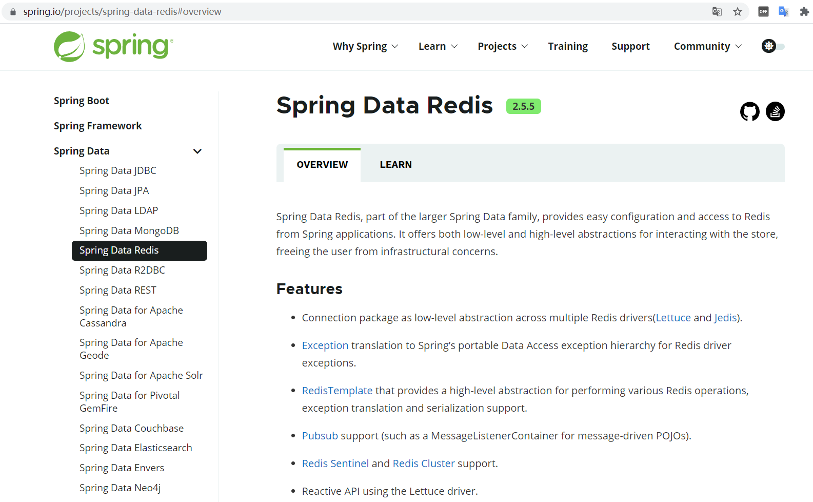 

Spring Boot提供了对应的Starter，maven坐标：

```xml
<dependency>
	<groupId>org.springframework.boot</groupId>
	<artifactId>spring-boot-starter-data-redis</artifactId>
</dependency>
```

Spring Data Redis中提供了一个高度封装的类：**RedisTemplate**，对相关api进行了归类封装,将同一类型操作封装为operation接口，具体分类如下：

- ValueOperations：string数据操作
- SetOperations：set类型数据操作
- ZSetOperations：zset类型数据操作
- HashOperations：hash类型的数据操作
- ListOperations：list类型的数据操作


#### 4.2.2 环境搭建

进入到sky-server模块

**1). 导入Spring Data Redis的maven坐标(已完成)**

```xml
<dependency>
     <groupId>org.springframework.boot</groupId>
     <artifactId>spring-boot-starter-data-redis</artifactId>
</dependency>
```

**2). 配置Redis数据源**

在application-dev.yml中添加

```yaml
sky:
  redis:
    host: localhost
    port: 6379
    password: 123456
    database: 10
```

**解释说明：**

database:指定使用Redis的哪个数据库，Redis服务启动后默认有16个数据库，编号分别是从0到15。

可以通过修改Redis配置文件来指定数据库的数量。

在application.yml中添加读取application-dev.yml中的相关Redis配置

```yaml
spring:
  profiles:
    active: dev
  redis:
    host: ${sky.redis.host}
    port: ${sky.redis.port}
    password: ${sky.redis.password}
    database: ${sky.redis.database}
```


**3). 编写配置类，创建RedisTemplate对象**

```java
package com.sky.config;

import lombok.extern.slf4j.Slf4j;
import org.springframework.context.annotation.Bean;
import org.springframework.context.annotation.Configuration;
import org.springframework.data.redis.connection.RedisConnectionFactory;
import org.springframework.data.redis.core.RedisTemplate;
import org.springframework.data.redis.serializer.StringRedisSerializer;

@Configuration
@Slf4j
public class RedisConfiguration {

    @Bean
    public RedisTemplate redisTemplate(RedisConnectionFactory redisConnectionFactory){
        log.info("开始创建redis模板对象...");
        RedisTemplate redisTemplate = new RedisTemplate();
        //设置redis的连接工厂对象
        redisTemplate.setConnectionFactory(redisConnectionFactory);
        //设置redis key的序列化器
        redisTemplate.setKeySerializer(new StringRedisSerializer());
        return redisTemplate;
    }
}
```

**解释说明：**

当前配置类不是必须的，因为 Spring Boot 框架会自动装配 RedisTemplate 对象。但默认的 key 序列化器为 `JdkSerializationRedisSerializer`，会把 key 序列化成带二进制前缀的不可读内容，导致存到 Redis 中后的数据和原始数据有差别，因此需要设置为 `StringRedisSerializer`。

**补充：RedisTemplate 中文乱码 / 序列化问题**

上面的配置只设置了 key 的序列化器，value 仍使用默认的 `JdkSerializationRedisSerializer`（中文会变成不可读的二进制内容）。如果 value 直接存字符串，建议 key、value 都用 `StringRedisSerializer`；如果 value 存 Java 对象，推荐用 `GenericJackson2JsonRedisSerializer` 序列化为 JSON：

```java
@Bean
public RedisTemplate<String, Object> redisTemplate(RedisConnectionFactory redisConnectionFactory) {
    RedisTemplate<String, Object> redisTemplate = new RedisTemplate<>();
    redisTemplate.setConnectionFactory(redisConnectionFactory);

    StringRedisSerializer stringSerializer = new StringRedisSerializer();
    GenericJackson2JsonRedisSerializer jsonSerializer = new GenericJackson2JsonRedisSerializer();

    // key、hashKey 用字符串序列化，保证 Redis 中可读
    redisTemplate.setKeySerializer(stringSerializer);
    redisTemplate.setHashKeySerializer(stringSerializer);
    // value 存对象用 JSON 序列化（纯字符串场景可直接用 StringRedisSerializer）
    redisTemplate.setValueSerializer(jsonSerializer);
    redisTemplate.setHashValueSerializer(jsonSerializer);

    redisTemplate.afterPropertiesSet();
    return redisTemplate;
}
```

> 注意：`GenericJackson2JsonRedisSerializer` 要求被序列化对象存在无参构造；若 value 只存字符串，把 `setValueSerializer` 换成 `StringRedisSerializer` 即可。


**4). 通过RedisTemplate对象操作Redis**

在test下新建测试类

```java
package com.sky.test;

import org.junit.jupiter.api.Test;
import org.springframework.beans.factory.annotation.Autowired;
import org.springframework.boot.test.context.SpringBootTest;
import org.springframework.data.redis.core.*;

@SpringBootTest
public class SpringDataRedisTest {
    @Autowired
    private RedisTemplate redisTemplate;

    @Test
    public void testRedisTemplate(){
        System.out.println(redisTemplate);
        //string数据操作
        ValueOperations valueOperations = redisTemplate.opsForValue();
        //hash类型的数据操作
        HashOperations hashOperations = redisTemplate.opsForHash();
        //list类型的数据操作
        ListOperations listOperations = redisTemplate.opsForList();
        //set类型数据操作
        SetOperations setOperations = redisTemplate.opsForSet();
        //zset类型数据操作
        ZSetOperations zSetOperations = redisTemplate.opsForZSet();
    }
}
```

测试：

 

说明RedisTemplate对象注入成功，并且通过该RedisTemplate对象获取操作5种数据类型相关对象。

上述环境搭建完毕后，接下来，我们就来具体对常见5种数据类型进行操作。


#### 4.2.3 操作常见类型数据

**RedisTemplate 操作接口与数据类型对应关系：**

| 操作接口 | 对应数据类型 |
| --- | --- |
| `opsForValue()` | string（bitmap 也通过它的 `setBit()` / `getBit()` 操作） |
| `opsForHash()` | hash |
| `opsForList()` | list |
| `opsForSet()` | set |
| `opsForZSet()` | zset 有序集合 |
| `opsForGeo()` | Geo 地理位置 |
| `opsForHyperLogLog()` | HyperLogLog 基数统计 |
| `opsForStream()` | stream 消息流 |
| `delete()` / `hasKey()` / `keys()` / `type()` 等 | 通用命令 |

> bitmap 没有独立的操作接口，位操作通过 `opsForValue().setBit()`、`getBit()` 完成；这也是 RedisTemplate 中 bit 没有单独 opsFor 类型的原因。

**1). 操作字符串类型数据**

```java
    /**
     * 操作字符串类型的数据
     */
    @Test
    public void testString(){
        // set get setex setnx
        redisTemplate.opsForValue().set("name","小明");
        String city = (String) redisTemplate.opsForValue().get("name");
        System.out.println(city);
        redisTemplate.opsForValue().set("code","1234",3, TimeUnit.MINUTES);
        redisTemplate.opsForValue().setIfAbsent("lock","1");
        redisTemplate.opsForValue().setIfAbsent("lock","2");
    }

```


**2). 操作哈希类型数据**

```java
    /**
     * 操作哈希类型的数据
     */
    @Test
    public void testHash(){
        //hset hget hdel hkeys hvals
        HashOperations hashOperations = redisTemplate.opsForHash();

        hashOperations.put("100","name","tom");
        hashOperations.put("100","age","20");

        String name = (String) hashOperations.get("100", "name");
        System.out.println(name);

        Set keys = hashOperations.keys("100");
        System.out.println(keys);

        List values = hashOperations.values("100");
        System.out.println(values);

        hashOperations.delete("100","age");
    }

```


**3). 操作列表类型数据**

```java
    /**
     * 操作列表类型的数据
     */
    @Test
    public void testList(){
        //lpush lrange rpop llen
        ListOperations listOperations = redisTemplate.opsForList();

        listOperations.leftPushAll("mylist","a","b","c");
        listOperations.leftPush("mylist","d");

        List mylist = listOperations.range("mylist", 0, -1);
        System.out.println(mylist);

        listOperations.rightPop("mylist");

        Long size = listOperations.size("mylist");
        System.out.println(size);
    }

```


**4). 操作集合类型数据**

```java
    /**
     * 操作集合类型的数据
     */
    @Test
    public void testSet(){
        //sadd smembers scard sinter sunion srem
        SetOperations setOperations = redisTemplate.opsForSet();

        setOperations.add("set1","a","b","c","d");
        setOperations.add("set2","a","b","x","y");

        Set members = setOperations.members("set1");
        System.out.println(members);

        Long size = setOperations.size("set1");
        System.out.println(size);

        Set intersect = setOperations.intersect("set1", "set2");
        System.out.println(intersect);

        Set union = setOperations.union("set1", "set2");
        System.out.println(union);

        setOperations.remove("set1","a","b");
    }

```


**5). 操作有序集合类型数据**

```java
    /**
     * 操作有序集合类型的数据
     */
    @Test
    public void testZset(){
        //zadd zrange zincrby zrem
        ZSetOperations zSetOperations = redisTemplate.opsForZSet();

        zSetOperations.add("zset1","a",10);
        zSetOperations.add("zset1","b",12);
        zSetOperations.add("zset1","c",9);

        Set zset1 = zSetOperations.range("zset1", 0, -1);
        System.out.println(zset1);

        zSetOperations.incrementScore("zset1","c",10);

        zSetOperations.remove("zset1","a","b");
    }

```

**6). 通用命令操作**

```java
    /**
     * 通用命令操作
     */
    @Test
    public void testCommon(){
        //keys exists type del
        Set keys = redisTemplate.keys("*");
        System.out.println(keys);

        Boolean name = redisTemplate.hasKey("name");
        Boolean set1 = redisTemplate.hasKey("set1");

        for (Object key : keys) {
            DataType type = redisTemplate.type(key);
            System.out.println(type.name());
        }

        redisTemplate.delete("mylist");
    }

```

### 4.3 生产环境配置要点

4.2 的环境搭建基于教学项目（sky-server）。标准 Spring Boot 项目中，不需要自定义 `sky.redis.*` 前缀再用 `${}` 占位符引用，直接使用官方标准前缀即可。

> **配置前缀版本说明：** Spring Boot 2.x 使用 `spring.redis.*`，Spring Boot 3.x 起改为 `spring.data.redis.*`，注意与自己的 Boot 版本对应。

**1）依赖**

即 4.2.1 引入的 `spring-boot-starter-data-redis`，无需重复引入。

**2）标准配置（application.yml）**

```yaml
spring:
  data:
    redis:
      host: r-xxxx.redis.rds.aliyuncs.com   # Redis 的 Host
      port: 6379                            # 连接端口
      password: xxxx                        # 连接密码（默认为空）
      database: 0                           # 数据库编号（默认 0-15）
```

**3）连接验证（单元测试）**

```java
// 启动类替换为自己项目的 Application 类
import org.junit.Assert;
import org.junit.Test;
import org.junit.runner.RunWith;
import org.springframework.beans.factory.annotation.Autowired;
import org.springframework.boot.test.context.SpringBootTest;
import org.springframework.data.redis.core.RedisTemplate;
import org.springframework.test.context.junit4.SpringRunner;

@RunWith(SpringRunner.class)
@SpringBootTest(classes = {Application.class})
public class RedisTest {
    @Autowired
    private RedisTemplate redisTemplate;

    @Test
    public void testRedisConnect() {
        redisTemplate.opsForValue().set("test", "test");
        Assert.assertTrue(redisTemplate.opsForValue().get("test").equals("test"));
        System.out.println("redis connect success");
    }
}
```

测试相关依赖（JUnit 4 与 Spring Boot 3.x 兼容写法；直接使用 `spring-boot-starter-test` 时默认已含 JUnit 5）：

```xml
<dependency>
    <groupId>junit</groupId>
    <artifactId>junit</artifactId>
    <version>4.13.1</version>
    <scope>test</scope>
</dependency>

<dependency>
    <groupId>org.springframework</groupId>
    <artifactId>spring-test</artifactId>
    <version>6.0.8</version>
    <scope>test</scope>
</dependency>

<dependency>
    <groupId>org.springframework.boot</groupId>
    <artifactId>spring-boot-test</artifactId>
    <version>3.1.5</version>
    <scope>test</scope>
</dependency>

<dependency>
    <groupId>org.springframework.boot</groupId>
    <artifactId>spring-boot-starter-test</artifactId>
    <scope>test</scope>
</dependency>
```

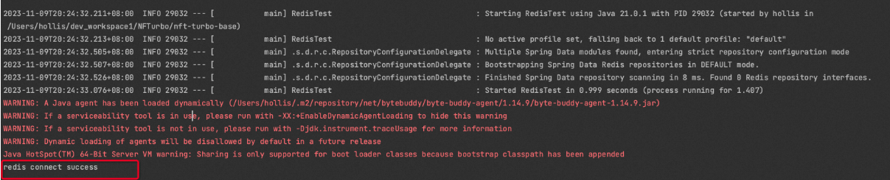

## 5. Redis线程模型

> 核心结论：整体线程模型 = **客户端多线程 + 服务端核心单线程**，依靠复合指令、事务、Pipeline、Lua 脚本、Function 等机制保证指令原子性；同时要重点关注 Bigkey 对单线程模型造成的阻塞风险。

### 5.1 Redis 到底是单线程还是多线程？

这是 Redis 面试中最经典的问题，几乎伴随 Redis 的整个发展过程。一句话结论：**客户端多线程，服务端核心单线程**。

#### 5.1.1 客户端多线程：维护 Socket 连接

Redis 为了支撑大量客户端同时连接，使用**多线程维护与客户端的 Socket 连接**，`redis.conf` 中 

`maxclients` 控制最大连接数：

```
# 默认最大连接数 10000，超过后新连接会被拒绝
# Redis is mostly single threaded, however there are certain threaded
# operations such as UNLINK, slow I/O accesses and other things that are
# performed on side threads.
#
# Now it is also possible to handle Redis clients socket reads and writes
# in different I/O threads. Since especially writing is so slow, normally
# Redis users use pipelining in order to speed up the Redis performances per
# core, and spawn multiple instances in order to scale more. Using I/O
# threads it is possible to easily speedup two times Redis without resorting
# to pipelining nor sharding of the instance.
#
# By default threading is disabled, we suggest enabling it only in machines
# that have at least 4 or more cores, leaving at least one spare core.
# Using more than 8 threads is unlikely to help much. We also recommend using
# threaded I/O only if you actually have performance problems, with Redis
# instances being able to use a quite big percentage of CPU time, otherwise
# there is no point in using this feature.
#
# So for instance if you have a four cores boxes, try to use 2 or 3 I/O
# threads, if you have a 8 cores, try to use 6 threads. In order to
# enable I/O threads use the following configuration directive:
#
# io-threads 4

# Set the max number of connected clients at the same time. By default
# this limit is set to 10000 clients, however if the Redis server is not
# able to configure the process file limit to allow for the specified limit
# the max number of allowed clients is set to the current file limit
# minus 32 (as Redis reserves a few file descriptors for internal uses).
#
# Once the limit is reached Redis will close all the new connections sending
# an error 'max number of clients reached'.
#
# IMPORTANT: When Redis Cluster is used, the max number of connections is also
# shared with the cluster bus: every node in the cluster will use two
# connections, one incoming and another outgoing. It is important to size the
# limit accordingly in case of very large clusters.
maxclients 10000
```

#### 5.1.2 服务端单线程：主线程处理网络 IO 与键值读写

服务端响应网络 IO 和键值对读写的请求，统一由一个**主线程**完成。Redis 基于 **epoll 实现 IO 多路复用**，让一个主线程同时响应多个客户端 Socket 连接的请求：

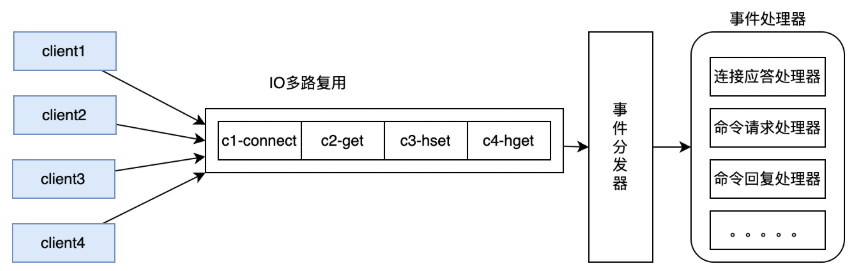

- 并发请求被转成**串行执行** → 天然没有 MySQL 那种脏读、幻读、不可重复读的并发问题；
- 串行化 + 基于内存工作的极高性能 → 让 Redis 成为很多并发问题的解决工具。

#### 5.1.3 线程模型的版本演进

| 版本 | 线程模型 |
| --- | --- |
| Redis 4.x 及以前 | 纯单线程 |
| Redis 5.x（2018-10 核心重构） | 大重构为后台多线程机制打基础 |
| Redis 6.x / 7.x | 引入全新多线程机制提升后台工作；网络 IO 支持 `io-threads` 多线程读写 |
| Redis 7.x | RDB/AOF 持久化、`unlink` 异步删除、集群数据同步、`FLUSHALL` 异步等耗时操作都由额外线程执行 |

```
# redis.conf 中可配置网络 IO 线程数（默认关闭，建议 4 核以上机器开启）
io-threads 4
```

现代 CPU 早已是多核架构，Redis 若一直单线程就无法发挥多核 CPU 的优势；且耗时操作必然影响主线程，所以**多线程是必然结果**，只不过为了保持快速，Redis 在多线程上走得非常谨慎。

#### 5.1.4 为什么核心线程坚持单线程？

1. **CPU 通常不是 Redis 的瓶颈**：性能瓶颈大部分是内存和网络，核心线程改多线程的要求并不急切；
2. **减少上下文切换**：单线程避免了线程上下文切换的性能消耗；
3. **避免资源竞争**：核心线程若改为多线程并发执行，必然带来资源竞争，极大增加业务复杂性，反而影响执行效率。

### 5.2 Redis 如何保证指令原子性

核心读写操作是单线程串行处理的，多个客户端同时读写只会排队串行。但**单条指令的原子性 ≠ 一个客户端多步操作的原子性**——针对单个客户端，Redis 并没有像 MySQL 事务那样保证同一客户端的操作整体原子性，多步操作之间仍可能被其他客户端的指令"加塞"。

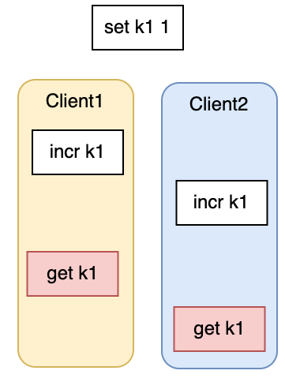

针对不同业务场景，Redis 提供了多种控制指令原子性的思路。

#### 5.2.1 复合指令

Redis 内部提供很多复合指令，一条指令干了多个指令的活，天然保持原子性：

- `MSET` / `HMSET`：批量设置
- `GETSET`：取值并赋新值
- `SETNX`：不存在才设置（分布式锁的常用基础）
- `SETEX`：设置值并指定过期时间

```bash
127.0.0.1:6379> MSET k1 v1 k2 v2
OK
```

#### 5.2.2 Redis 事务（MULTI / EXEC）

不会被插队

| 命令 | 作用 |
| --- | --- |
| `MULTI` | 开启事务 |
| `EXEC` | 执行事务 |
| `DISCARD` | 放弃事务 |
| `WATCH` | 监听 key，key 有变化后事务不执行 |
| `UNWATCH` | 取消监听（只在当前客户端生效） |

```bash
127.0.0.1:6379> MULTI
OK
127.0.0.1:6379(TX)> set k2 2
QUEUED
127.0.0.1:6379(TX)> incr k2
QUEUED
127.0.0.1:6379(TX)> get k2
QUEUED
127.0.0.1:6379(TX)> EXEC
1) OK
2) (integer) 3
3) "3"
```

> 开启事务后，所有操作返回 `QUEUED`，表示只是排好了队，等到 `EXEC` 后一起执行。

**Redis 事务 ≠ 数据库事务**：它**不保证事务中的指令一起成功或一起失败**，只保证事务中的原子操作**一起执行，不会被其他指令加塞**。

对于Redis事务的更多说明，参见官网 <https://redis.io/docs/latest/develop/interact/transactions/>

```bash
# lpop 是针对 list 的操作，现在对 string 类型的 k2 操作，必然报错
127.0.0.1:6379(TX)> lpop k2
QUEUED
127.0.0.1:6379(TX)> incr k2
QUEUED
127.0.0.1:6379(TX)> EXEC
1) OK
2) (integer) 3
3) "3"
4) (error) WRONGTYPE Operation against a key holding the wrong kind of value
5) (integer) 4
6) "4"
```

可以看到：某条指令报错**不会让整个事务回滚，也不影响后面指令的执行**。

**事务失败如何"回滚"——回滚的是操作，不是数据：**

- 在 `EXEC` 执行前失败（指令敲错、参数不对）→ 整个事务的操作都不会执行；
- 在 `EXEC` 执行后失败（如 key 类型不对）→ 事务中其他操作正常执行，不受影响。

**执行过程中的注意点：**

1. 只要客户端执行了 `EXEC`，之后即使连接断开，事务也会一直执行下去；
2. 事务可能造成数据不一致：`EXEC` 后 Redis 先将事务中所有操作记录到 AOF 文件，再执行具体操作。若记录后、执行中服务非正常宕机（崩溃或被 kill -9），AOF 记录与数据不符，下次启动会报错，需用 `redis-check-aof` 工具修复（移除不完整的事务操作记录）；
3. `WATCH` 机制可以进一步保证事务执行前某个 key 不被修改；`UNWATCH` 取消监听只在当前客户端有效。

#### 5.2.3 Pipeline 管道

**使用场景**

如果你有大批量的数据需要快速写入到Redis中，这种方式可以一定程度提高执行效率

具体参考官网：<https://redis.io/docs/latest/develop/use/pipelining/>

**核心作用：优化 RTT（Round-Trip Time）**。RTT 指指令数据包从 Client → Server → Client 的往返时间，指令越频繁 RTT 消耗越可观。

Pipeline 的思路简单明了：**将客户端多个指令打包，一起推送给服务端**，一次往返完成多笔操作。

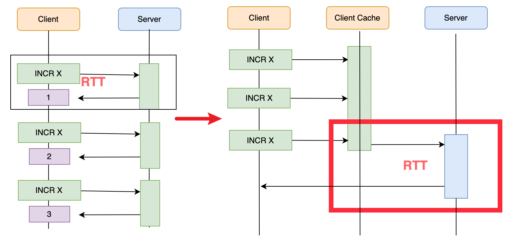

原始文件command.txt

```shell
set count 1
incr count
incr count
incr count
```

指令执行

```bash
# command.txt 中包含多条指令，一次管道批量执行
[root@localhost ~]# cat command.txt | redis-cli -a 123qweasd --pipe
All data transferred. Waiting for the last reply...
Last reply received from server.
errors: 0, replies: 4
```

**注意点：**

1. **Pipeline 不具备原子性**：只是将多条命令发送到服务端，最终仍可能被其他客户端的指令加塞（虽然概率较小），所以不建议在 Pipeline 中做复杂的数据操作；

2. 执行复合指令和事务会**阻塞其他命令执行**，而执行 Pipeline 不会；

3. Pipeline 执行过程中会**阻塞当前客户端**，不建议拼装过多指令——指令过多会使客户端阻塞太久，且服务端需要回复繁忙客户端、占用大量内存；

4. 适合在**非热点时段**做大批量数据调整任务（如批量写入）。


**使用案例**

nc 建立tcp连接 redis-cli 

```shell
[root@192-168-65-214 ~]# printf "AUTH 123qweasd\r\nPING\r\nPING\r\nPING\r\n" | nc localhost 6379
+OK
+PONG
+PONG
+PONG
```

#### 5.2.4 Lua 脚本（最常用）

Redis 事务和 Pipeline 对原子性问题都有"水土不服"的地方，且都只是对现有指令进行拼凑，无法承载自定义复杂逻辑。因此企业中用到更多的是 **Lua 脚本**，也是 Redis 7 版本着重调整的功能。

[The Programming Language Lua](https://www.lua.org/)

> 如果你对lua原生的语法感兴趣，推荐一个参考网站：<https://wiki.luatos.com/> 这个网站可以直接在线调试lua语法，简单轻松无压力。

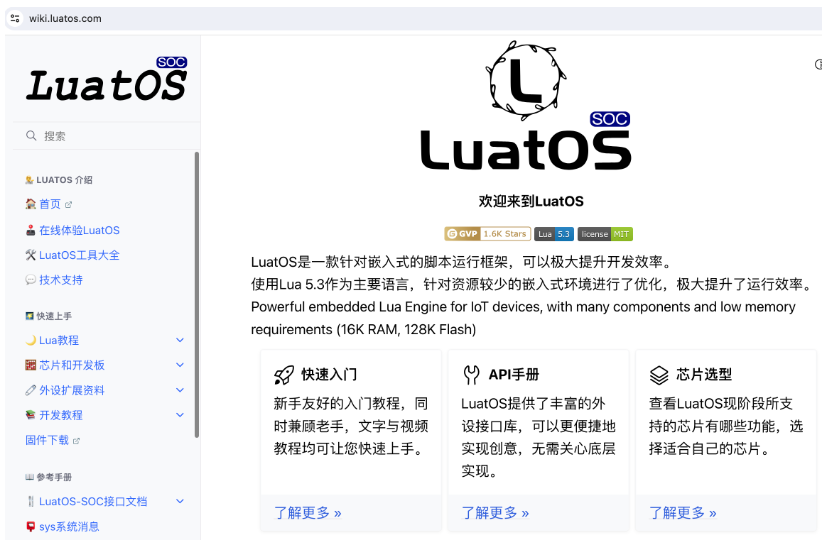

Lua 是一种小巧的脚本语言，拥有很多高级语言的特性。比如参数类型、作用域、函数等。最大特点是**单线程模型**，天然适合 Redis、Nginx 这类单线程中间件做功能定制——**在 Redis 中执行一段 Lua 脚本，天然就是原子性的**（Redis 7.x 支持 Lua 5.1）。

**Redis中如何执行lua？**

Redis中对lua语言的API介绍参考官网： <https://redis.io/docs/latest/develop/interact/programmability/lua-api/>

Redis中对lua支持从2.6.0版本就已经开始了。具体参考指令可以使用 help eval指令查看

>   127.0.0.1:6379> help eval
>
>   EVAL script numkeys [key [key ...]] [arg [arg ...]]
>   summary: Executes a server-side Lua script.
>   since: 2.6.0
>   group: scripting  

- script参数是一段Lua脚本程序，它会被运行在Redis服务器上下文中，这段脚本不必(也不应该)定义为一 个Lua函数。
- numkeys参数用于指定键名参数的个数。键名参数 key [key ...] 从EVAL的第三个参数开始算 起，表示在脚本中所用到的那些Redis键(key)，这些键名参数可以在 Lua中通过全局变量KEYS数组，用1 为基址的形式访问( KEYS[1] ， KEYS[2] ，以此类推)。
- 在命令的最后，那些不是键名参数的附加参数 arg [arg ...] ，可以在Lua中通过全局变量ARGV数组访问， 访问的形式和KEYS变量类似( ARGV[1] 、 ARGV[2] ，诸如此类)。

**执行方式：**

```bash
# EVAL：script 为脚本，numkeys 指定键名参数个数，
# KEYS[i] 访问键名参数，ARGV[i] 访问附加参数（均以 1 为基址）
127.0.0.1:6379> eval "return {KEYS[1],KEYS[2],ARGV[1],ARGV[2]}" 2 key1 key2 first second
1) "key1"
2) "key2"
3) "first"
4) "second"

# 脚本内使用 redis.call() 调用 Redis 命令
# 调整 1 号商品的库存：若库存小于 10 就设置为 10
127.0.0.1:6379> set stock_1 1
OK
127.0.0.1:6379> eval "local initcount = redis.call('get', KEYS[1]) local a = tonumber(initcount) local b = tonumber(ARGV[1]) if a >= b then redis.call('set', KEYS[1], a) return 1 end redis.call('set', KEYS[1], b) return 0 " 1 "stock_1" 10
(integer) 0
127.0.0.1:6379> get stock_1
"10"
```

格式化脚本

```lua
local initcount = redis.call('get', KEYS[1])
local a = tonumber(initcount) -- 读取stock_1的值转数字
local b = tonumber(ARGV[1])   -- b=10
if a >= b then
    redis.call('set', KEYS[1], a) -- 原值不变
    return 1
end
redis.call('set', KEYS[1], b)     -- 把key设置成b
return 0
```

**使用注意点：**

1. **不要在脚本中出现死循环和耗时运算**，否则 Redis 会阻塞、不再接受其他命令（这一点与 Pipeline 不同，Pipeline 不会阻塞服务端）。Redis 有配置参数控制 Lua 脚本最长执行时间，**默认 5 秒**；超时后 Redis 对其他操作返回 `BUSY` 错误，此时只允许执行 `SCRIPT KILL`、`FUNCTION KILL`、`SHUTDOWN NOSAVE` 等少量命令：

```shell
# redis.conf：控制 EVAL 脚本、Function 的最大执行时间（默认 5000ms）
lua-time-limit 5000
# busy-reply-threshold 5000   # 旧名称，现在是别名
```

2. **尽量使用只读脚本**：只读脚本是 Redis 7 新增，表示不修改数据集的脚本，加只读标志后用 `EVAL_RO` 触发；不允许执行任何修改数据集的操作，可随时用 `SCRIPT KILL` 停止；好处是能限制某些用户的操作，且可转移到备份节点执行、减轻主节点压力；
3. **热点脚本可以缓存到服务端**：`SCRIPT LOAD` 将脚本缓存到服务端并返回 SHA1 校验和，之后用 `EVALSHA` 直接执行，省去每次传输脚本内容：

```bash
127.0.0.1:6379> SCRIPT LOAD "return 'Immabe a cached script'"
"c664a3bf70bd1d45c4284ffebb65a6f2299bfc9f"
127.0.0.1:6379> EVALSHA c664a3bf70bd1d45c4284ffebb65a6f2299bfc9f 0
"Immabe a cached script"
```

#### 5.2.5 Redis Function（Redis 7+）

如果觉得开发 Lua 脚本有困难，Redis 7 之后提供了另一种解法——**Redis Function**：将一些功能声明成统一的函数，提前加载到 Redis 服务端（可由管理员加载），客户端直接调用即可，无需关心函数实现。

**Function 更大的好处：Function 中可以嵌套调用其他 Function**，从而更有利于代码复用；相比之下 Lua 脚本无法复用。

**示例**：在服务器上新增 `mylib.lua` 文件（注意：第一行是指定函数的命名空间，**不是注释，不能少**）：

```lua
#!lua name=mylib

local function my_hset(keys, args)
    local hash = keys[1]
    local time = redis.call('TIME')[1]
    return redis.call('HSET', hash, '_last_modified_', time, unpack(args))
end

redis.register_function('my_hset', my_hset)
```

加载并调用：

```bash
[root@localhost myredis]# cat mylib.lua | redis-cli -a 123qweasd -x FUNCTION LOAD REPLACE
"mylib"
127.0.0.1:6379> FUNCTION LIST
1) 1) "library_name"
   2) "mylib"
   3) "engine"
   4) "LUA"
   5) "functions"
   6) 1) 1) "name"
      2) "my_hset"
...
127.0.0.1:6379> FCALL my_hset 1 myhash myfield "some value" another_field "another value"
(integer) 3
127.0.0.1:6379> HGETALL myhash
1) "_last_modified_"
2) "1717748001"
3) "myfield"
4) "some value"
5) "another_field"
6) "another value"
```

help @scripting

**Function 注意点：**

1. Function 同样可以进行只读调用；
2. 集群中使用时，目前版本需要在**各个节点手动加载一次**，Redis 不会在集群中自动同步；
3. Function 缓存在服务端，不建议加载太多太大；
4. Function 和 Script 一样有一系列管理指令，`help @scripting` 自行了解。

#### 5.2.6 原子性机制对比

| 机制 | 是否原子 | 特点 | 适用场景 |
| --- | --- | --- | --- |
| 复合指令 | 是 | 一条指令完成多步操作 | 简单批量读写 |
| Redis 事务 | 是（一起执行不被加塞，但不回滚失败指令） | MULTI/EXEC 排队执行，支持 WATCH | 需要"不被加塞"的批量操作 |
| Pipeline | 否 | 多命令打包发送，优化 RTT，不阻塞服务端 | 非热点时段大批量数据调整 |
| Lua 脚本 | 是 | 可承载自定义复杂逻辑，天然原子 | 高并发复杂业务（最常用） |
| Redis Function | 是 | 函数化、可嵌套复用，Redis 7+ | 替代复杂 Lua 脚本 |

> 以上机制本质都是**改变 Redis 指令执行顺序**的方式。实际项目中 Lua 脚本通常用得最多，在很多追求极致性能的高并发场景中担任重要角色；但其他方式也需要了解，真实业务场景下才有更多方案可选。

### 5.3 Redis 中的 Bigkey 问题

redis-cli --help

**Bigkey** 指占用空间非常大的 key，例如一个 list 包含 200W 个元素，或一个 string 里放一篇文章。基于 Redis **单线程为主**的核心机制，操作这些 Bigkey 非常容易造成**服务阻塞**，实际项目中一定要特殊关照。

Redis 客户端提供了两个扩展参数，帮助快速发现 Bigkey：

复杂度高

```bash
# 找出元素很多（复杂度高）的 key
redis-cli --bigkeys
(base) PS C:\Users\Zhuph> redis-cli --bigkeys

# Scanning the entire keyspace to find biggest keys as well as
# average sizes per key type.  You can use -i 0.1 to sleep 0.1 sec
# per 100 SCAN commands (not usually needed).

100.00% ||||||||||||||||||||||||||||||||||||||||||||||||||||||||||||
Keys sampled: 103

-------- summary -------

Total key length in bytes is 2890 (avg len 28.06)

Biggest   hash found "redis:hash:1" has 11 fields
Biggest stream found "s1" has 3 entries
Biggest string found "nfturbo:inviteCode" has 115250 bytes
Biggest    set found "redis:set:all" has 4 members
Biggest   zset found "changsha" has 4 members

0 lists with 0 items (00.00% of keys, avg size 0.00)
19 hashs with 66 fields (18.45% of keys, avg size 3.47)
2 streams with 5 entries (01.94% of keys, avg size 2.50)
75 strings with 232074 bytes (72.82% of keys, avg size 3094.32)
1 sets with 4 members (00.97% of keys, avg size 4.00)
6 zsets with 12 members (05.83% of keys, avg size 2.00)
```

内存很大

```shell
# 找出占用内存很大的 key
redis-cli --memkeys
(base) PS C:\Users\Zhuph> redis-cli --memkeys

# Scanning the entire keyspace to find biggest keys as well as
# average sizes per key type.  You can use -i 0.1 to sleep 0.1 sec
# per 100 SCAN commands (not usually needed).

100.00% ||||||||||||||||||||||||||||||||||||||||||||||||||||||||||||
Keys sampled: 103

-------- summary -------

Total key length in bytes is 2890 (avg len 28.06)

Biggest   hash found "ai:chat:zhuph" has 6941 bytes
Biggest stream found "mystream" has 1373 bytes
Biggest string found "nfturbo:inviteCode" has 115297 bytes
Biggest    set found "redis:set:all" has 1607 bytes
Biggest   zset found "{nfturbo:limit:limit#COLLECTIONf64e5fbe-2626-4f2b-9628-c28a9b5483c3}:permits" has 137 bytes

0 lists with 0 bytes (00.00% of keys, avg size 0.00)
19 hashs with 12967 bytes (18.45% of keys, avg size 682.47)
2 streams with 1673 bytes (01.94% of keys, avg size 836.50)
75 strings with 235579 bytes (72.82% of keys, avg size 3141.05)
1 sets with 1607 bytes (00.97% of keys, avg size 1607.00)
6 zsets with 690 bytes (05.83% of keys, avg size 115.00)
```

### 5.4 线程模型总结

1. Redis 整体还是**多线程**的，只是后台执行指令的**核心线程是单线程**，整个线程模型以单线程为主，不同客户端的各种指令依次排队执行；

2. 这种以单线程为主的模型相比其他中间件非常简单，让 Redis 处理线程并发问题简单高效，甚至在很多复杂业务场景下成为**并发控制工具**；但这不意味着没有并发问题——**选择合理的指令执行方式**非常重要；

3. 简单的线程模型本身**不利于发挥多线程的并发优势**，而 Redis 的应用场景又通常与高性能深度绑定，所以使用时要时刻思考指令执行方式（复合指令、事务、Pipeline、Lua、Function），才能最大限度发挥 Redis 高性能的优势。

   多核计算机

## 6. Redis数据安全性

> 核心结论：Redis 的数据安全 = **单机持久化**（RDB/AOF/混合）＋**分布式冗余**（主从复制）＋**高可用**（哨兵/集群），层层递进。持久化只保证单机数据安全，若服务器磁盘损坏，再好的持久化策略也无济于事；因此分布式部署架构才是 Redis 数据安全的最终保障。

### 6.1 性能压测：在数据安全与读写性能之间找平衡

```
redis-server ./redis.conf
```

Redis 所有数据保存在内存中，得益于内存高效的读写性能，Redis 性能非常强悍。但内存的缺点是**断电即丢失**，所以在实际项目中，一旦需要保存重要数据，就不可能完全依赖内存。真实项目使用 Redis，一定要针对应用场景进行性能估算，在**数据安全性与读写性能之间找到平衡点**。

Redis 提供了压测脚本 `redis-benchmark`，可以对 Redis 进行快速基准测试：

```shell
# 20 个线程、100W 个请求，测试 set 指令（写数据）
[root@zhuph redis-stable]# redis-benchmark -a zhuph -t set -n 1000000 -c 20
====== SET ======
  1000000 requests completed in 6.65 seconds
  20 parallel clients
  3 bytes payload
  keep alive: 1
  host configuration "save": 3600 1 300 100 60 10000
  host configuration "appendonly": no
  multi-thread: no

Latency by percentile distribution:
0.000% <= 0.031 milliseconds (cumulative count 1)
50.000% <= 0.071 milliseconds (cumulative count 708718)
75.000% <= 0.079 milliseconds (cumulative count 811032)
87.500% <= 0.103 milliseconds (cumulative count 885719)
93.750% <= 0.135 milliseconds (cumulative count 938906)
96.875% <= 0.183 milliseconds (cumulative count 970812)
98.438% <= 0.215 milliseconds (cumulative count 985902)
99.219% <= 0.247 milliseconds (cumulative count 992252)
99.609% <= 0.295 milliseconds (cumulative count 996563)
99.805% <= 0.327 milliseconds (cumulative count 998092)
99.902% <= 0.383 milliseconds (cumulative count 999097)
99.951% <= 0.471 milliseconds (cumulative count 999548)
99.976% <= 0.583 milliseconds (cumulative count 999757)
99.988% <= 0.783 milliseconds (cumulative count 999881)
99.994% <= 0.951 milliseconds (cumulative count 999939)
99.997% <= 1.247 milliseconds (cumulative count 999972)
99.998% <= 1.303 milliseconds (cumulative count 999986)
99.999% <= 1.519 milliseconds (cumulative count 999994)
100.000% <= 1.543 milliseconds (cumulative count 999997)
100.000% <= 1.551 milliseconds (cumulative count 999999)
100.000% <= 1.559 milliseconds (cumulative count 1000000)
100.000% <= 1.559 milliseconds (cumulative count 1000000)

Cumulative distribution of latencies:
88.572% <= 0.103 milliseconds (cumulative count 885719)
98.341% <= 0.207 milliseconds (cumulative count 983408)
99.699% <= 0.303 milliseconds (cumulative count 996986)
99.929% <= 0.407 milliseconds (cumulative count 999290)
99.962% <= 0.503 milliseconds (cumulative count 999620)
99.978% <= 0.607 milliseconds (cumulative count 999779)
99.985% <= 0.703 milliseconds (cumulative count 999851)
99.989% <= 0.807 milliseconds (cumulative count 999893)
99.993% <= 0.903 milliseconds (cumulative count 999931)
99.995% <= 1.007 milliseconds (cumulative count 999945)
99.995% <= 1.103 milliseconds (cumulative count 999949)
99.996% <= 1.207 milliseconds (cumulative count 999958)
99.999% <= 1.303 milliseconds (cumulative count 999986)
99.999% <= 1.407 milliseconds (cumulative count 999989)
99.999% <= 1.503 milliseconds (cumulative count 999990)
100.000% <= 1.607 milliseconds (cumulative count 1000000)

Summary:
  throughput summary: 150398.55 requests per second ##平均每秒15W次写操作。
  latency summary (msec):
          avg       min       p50       p95       p99       max
        0.078     0.024     0.071     0.151     0.239     1.559
```

> 更多参数使用 `redis-benchmark --help` 查看；调整部署架构（主从/哨兵/集群）后，建议多进行几次对比测试。

### 6.2 数据持久化机制（单机数据安全）

> 官网介绍：https://redis.io/docs/latest/operate/oss_and_stack/management/persistence/

```
Persistence refers to the writing of data to durable storage, such as a solid-state disk (SSD). Redis provides a range of persistence options. These include:

RDB (Redis Database): RDB persistence performs point-in-time snapshots of your dataset at specified intervals.
AOF (Append Only File): AOF persistence logs every write operation received by the server. These operations can then be replayed again at server startup, reconstructing the original dataset. Commands are logged using the same format as the Redis protocol itself.
No persistence: You can disable persistence completely. This is sometimes used when caching.
RDB + AOF: You can also combine both AOF and RDB in the same instance.
```

#### 6.2.1 配置文件

redis.conf

```shell
[root@zhuph redis] # cat redis6379.conf
loadmodule /root/myredis/basic/redisbloom.so
bind * -::/*
protected-mode no
port 6379
daemonize yes
requirepass 123qweasd
pidfile /var/run/redis_6379.pid
logfile "/root/myredis/basic/logs/6379.log"
save 3600 1 300 100 60 10000
dbfilename dump.rdb
dir /root/myredis/basic/db
appendonly yes
appendfilename "appendonly.aof"
appenddirname "appendonlydir"
# 默认 everysec
# appendfsync always
appendfsync everysec
# appendfsync no
# 默认值
auto-aof-rewrite-percentage 100
auto-aof-rewrite-min-size 64mb

enable-debug-command local
```

#### 6.2.2 持久化策略总览

Redis 提供了很多与数据持久化相关的配置，大体上可以组成以下几种策略：

| 策略 | 说明 | 数据安全程度 |
| --- | --- | --- |
| 无持久化 | 完全关闭数据持久化 | 不保证（相当于纯缓存） |
| RDB(RedisDatabase） | 按一定时间间隔保存全量数据快照 | 非实时，总有数据丢失可能 |
| AOF(Append Only File) | 记录每一次写操作，通过操作重演恢复 | 更安全（默认每秒最多丢 1 秒） |
| RDB + AOF | 同时保存数据快照和操作日志 | 最完整（恢复更快） |

**整体使用建议：**

1. 只是把 Redis 当缓存用 → 直接关闭持久化；
2. 关注数据安全、可接受宕机时小部分数据损失 → 使用 RDB，性能较高；
3. **不建议单独使用 AOF**，RDB 配合 AOF 可以让数据恢复更快。

#### 6.2.3 RDB 快照持久化

**1）能干什么**

RDB 在指定的时间间隔，将当前时间点内存中的**全部数据集**备份到磁盘文件（默认 `dump.rdb`），恢复时再把快照文件直接读回内存。由于存的是全量数据，甚至可以直接用 RDB 传递数据——例如把最近的 RDB 文件复制到另一个 Redis 服务（最好是同版本），即可完成数据迁移。

**2）重要配置**

```
################################ SNAPSHOTTING  ################################

# Save the DB to disk.
#
# save <seconds> <changes> [<seconds> <changes> ...]
#
# Redis will save the DB if the given number of seconds elapsed and it
# surpassed the given number of write operations against the DB.
#
# Snapshotting can be completely disabled with a single empty string argument
# as in following example:
#
# save ""
#
# Unless specified otherwise, by default Redis will save the DB:
#   * After 3600 seconds (an hour) if at least 1 change was performed
#   * After 300 seconds (5 minutes) if at least 100 changes were performed
#   * After 60 seconds if at least 10000 changes were performed
#
# You can set these explicitly by uncommenting the following line.
#
# save 3600 1 300 100 60 10000

```


| 配置项 | 默认值 | 说明 |
| --- | --- | --- |
| `save <seconds> <changes>` | `3600 1 300 100 60 10000` | 核心配置：N 秒内发生 M 次写操作即触发快照；`save ""` 可完全禁用 |
| `dir` | `./` | 快照文件保存目录 |
| `dbfilename` | `dump.rdb` | 快照文件名 |
| `rdbcompression` | `yes` | 是否启用 RDB 压缩；不想消耗 CPU 可设为 `no` |
| `stop-writes-on-bgsave-error` | `yes` | 快照写入失败时是否停止写入；设为 `no` 表示不在乎数据不一致，快照失败也继续接受写请求 |
| `rdbchecksum` | `yes` | 保存快照后用 CRC64 算法校验数据（约增加 10% 性能消耗）；追求极致性能可关闭 |

```ini
# save <seconds> <changes>，默认策略：
# 3600 秒（1 小时）内至少 1 次写操作
# 300 秒（5 分钟）内至少 100 次写操作
# 60 秒内至少 10000 次写操作
save 3600 1 300 100 60 10000
```

**3）触发时机**

1. 到达配置文件中默认的快照条件 → 自动触发；

2. 手动执行 `save` 或 `bgsave`：

   `save` 会**阻塞主线程**直到备份完成；

   `bgsave` 不阻塞主线程，但会 fork 子进程复制一份内存数据，**占用更多内存和 CPU**；

   ```
   [root@zhuph redis-stable]# redis-cli -a zhuph
   Warning: Using a password with '-a' or '-u' option on the command line interface may not be safe.
   127.0.0.1:6379> save
   OK
   127.0.0.1:6379> bgsave
   Background saving started
   [root@zhuph redis]# last save
   wtmp begins Sun Jul  7 16:46:02 2019
   ```

3. 主从复制建立时 → 触发 RDB 备份（见 6.3 节）。

用 `LASTSAVE` 指令可查看最后一次成功执行快照的时间（毫秒级 LONG 数字，Linux 中可用 `date -d @{timestamp}` 快速格式化）。

**4）优缺点**

| 优点 | 缺点 |
| --- | --- |
| RDB 文件非常紧凑，适合定期备份数据 | 不能实时备份，总有数据丢失的可能 |
| 快照非常适合灾难恢复 | fork 子进程需要克隆内存数据，数据量太大或 CPU 性能差时，会造成 Redis 短暂停用 |
| 备份对主线程性能几乎没有影响（子进程完成） | |
| 大数据量重启时比 AOF 快很多 | |

#### 6.2.4 AOF 追加持久化

binlog

**1）能干什么**

以日志形式记录**每个写操作**（读操作不记录），只允许追加、不允许改写文件；恢复时通过重演操作日志还原数据。

**2）重要配置**

| 配置项 | 默认值 | 说明 |
| --- | --- | --- |
| `appendonly` | `no` | 是否开启 AOF |
| `appendfilename` | `appendonly.aof` | AOF 文件名称 |
| `appendfsync` | `everysec` | 同步策略（见下表） |
| `appenddirname` | `appendonlydir` | AOF 目录（实际目录为 `{dir}+{appenddirname}`） |
| `auto-aof-rewrite-percentage` | `100` | 重写触发百分比 |
| `auto-aof-rewrite-min-size` | `64mb` | 重写触发最小体积 |
| `no-appendfsync-on-rewrite` | `no` | AOF 重写期间是否同步刷盘 |

**appendfsync 三种策略：**

| 策略 | 说明 | 安全性 / 性能 |
| --- | --- | --- |
| `always` | 每次写操作都刷盘 | 最安全，性能最低 |
| `everysec` | 每秒刷盘一次（默认） | 平衡，崩溃最多丢 1 秒数据 |
| `no` | 不主动刷盘，交由操作系统决定 | 性能最高，安全性最低 |

**Redis 7 的多文件结构：**

Redis 7 将原来单个 AOF 文件拆分为三类文件：`base.rdb`（二进制数据快照）＋`incr.aof`（增量操作日志）＋`manifest`（记录文件信息的元文件）：

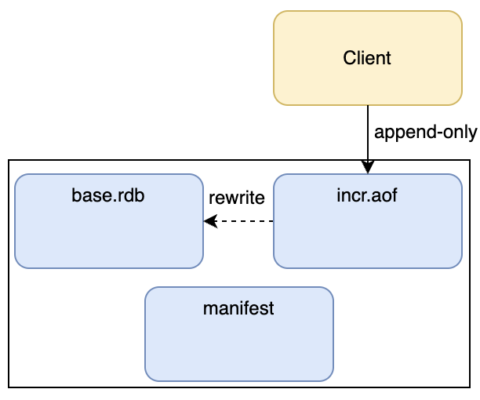

- 现在的 AOF 已经具备了 **RDB + AOF** 的功能（base 文件即 RDB 快照）；
- 拆分增量文件的方式，可以进一步控制单个 AOF 文件的大小；
- Redis 会定期对 AOF 操作进行**优化重写**（例如把多个 `INCR` 合并成一个 `SET`），也可用 `BGREWRITEAOF` 手动触发；重写后生成新的 base.rdb 和 incr.aof 文件。

**3）AOF 文件内容解析**

打开 `appendonly.aof.1.incr.aof` 增量文件，里面按照 Redis 协议记录了每一次操作：

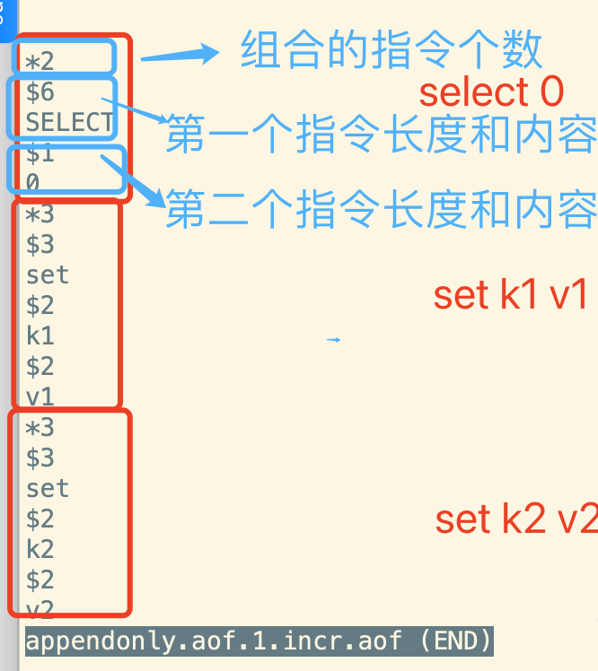

这就是 Redis 的指令协议：以 `set k1 v1` 为例，`*3` 表示该指令由 3 个部分组成，`$3 set` 表示第一个部分是 3 个字符长度的 `set`……Redis 就是通过 TCP 协议一次次解析这些指令。了解这个协议后，甚至可以直接手写一个简单的 Redis 客户端。

**4）AOF 日志恢复**

如果服务异常导致 AOF 日志记录不完整（例如手动往日志文件末尾追加文字模拟），重启会失败并报错：

```log
21773:M 11 Jun 2024 18:22:43.928 # Bad file format reading the append only file appendonly.aof.1.incr.aof: make a backup of your AOF file, then use ./redis-check-aof --fix <filename.manifest>
```

使用 `redis-check-aof --fix` 修复（本质上是把最后一条不完整的指令删除）：

```shell
redis-check-aof --fix appendonly.aof.1.incr.aof
```

> RDB 文件同样提供修复指令 `redis-check-rdb`，但 RDB 是二进制压缩文件、一般不太可能被篡改，所以用得不多。**应用层误操作（如误执行 FLUSHALL）也可以用 AOF 恢复**：删除日志中最后一条 FLUSHALL 指令，重启即可恢复全部数据。

**5）优缺点**

| 优点 | 缺点 |
| --- | --- |
| 更安全：默认每秒一次写入，崩溃最多损失 1 秒操作 | 同样数据集下，AOF 文件通常比 RDB 更大 |
| 追加式记录，不会出现记录不完整；损坏可用 redis-check-aof 轻松修复 | 写操作频繁时，备份性能通常比 RDB 慢 |
| AOF 文件太大时自动切换新日志文件，防止单文件过大 | |
| 记录方式简单易懂，可手动编辑日志（如删除误操作的 FLUSHALL 指令） | |

#### 6.2.5 混合持久化（RDB + AOF）

RDB 和 AOF 各有优劣，Redis 支持同时开启两种持久化策略：

```ini
# Redis 可以创建 RDB 或 AOF 格式的 base 文件；RDB 格式总是更快更高效
# Redis can create append-only base files in either RDB or AOF formats. Using
# the RDB format is always faster and more efficient, and disabling it is only
# supported for backward compatibility purposes.
aof-use-rdb-preamble yes
```

**恢复顺序：** 同时开启时，Redis 恢复数据**优先从 AOF 文件恢复**——因为 AOF 的数据集通常比 RDB 更完整，且 AOF 已包含 RDB 格式的 base 文件，恢复效率也比较高。

**注意：** 既然重启只找 AOF，是否就不需要 RDB 备份了？**仍然建议保留 RDB 定期备份**——AOF 数据不断变化，不太利于定期备份；保留 RDB 文件，作为保证数据安全的"后手"。

> 持久化只能保证**单机**数据安全：如果服务器磁盘坏了，再好的持久化策略也无济于事。要进一步保证数据安全，就需要下面三种集群化方案。

### 6.3 主从复制：数据冗余与容灾（数据安全①）

> 部署细节见 2.3 节。主从复制、哨兵、集群三种分布式方案，都是在分布式场景下保护数据安全与分摊流量的方案，**层层递进**。

#### **6.3.1 Replica是什么？有什么用？**

官网介绍：<https://redis.io/docs/latest/operate/oss_and_stack/management/replication/>

redis.conf中的描述

```ini
# Master-Replica replication. Use replicaof to make a Redis instance a copy of
# another Redis server. A few things to understand ASAP about Redis replication.
#
#   +------------------+      +---------------+
#   |      Master      | ---> |    Replica    |
#   | (receive writes) |      |  (exact copy) |
#   +------------------+      +---------------+
#
# 1) Redis replication is asynchronous, but you can configure a master to
#    stop accepting writes if it appears to be not connected with at least
#    a given number of replicas.
# 2) Redis replicas are able to perform a partial resynchronization with the
#    master if the replication link is lost for a relatively small amount of
#    time. You may want to configure the replication backlog size (see the next
#    sections of this file) with a sensible value depending on your needs.
# 3) Replication is automatic and does not need user intervention. After a
#    network partition replicas automatically try to reconnect to masters
#    and resynchronize with them.	
```

简单总结：主从复制。当Master数据有变化时，自动将新的数据异步同步到其他slave中。

最典型的作用：

- 读写分离：mater以写为主，Slave以读为主
- 数据备份+容灾恢复

#### **6.3.2 如何配置Replica？**

一个原则：**配从不配主**。 这意味着对于一个Redis服务，可以在几乎没有影响的情况下，给他配置一个或者多个从节点。

相关核心操作简化为以下几点：

- REPLICAOF host port|NO ONE : 一般配置到redis.conf中。
- SLAVEOF host port|NO ONE： 在运行期间修改slave节点的信息。如果该服务已经是某个主库的从库了，那么就会停止和原master的同步关系。

#### **6.3.3 如何确定主从状态？从库可以写数据吗？**

主从状态可以通过 info replication查看。

例如，在一个主从复制的master节点上查看到的主从状态是这样的：

- master

```shell
127.0.0.1:6379> info replication
# Replication
role:master
connected_slaves:1
slave0:ip=192.168.65.214,port=6380,state=online,offset=56,lag=1
master_failover_state:no-failover
master_replid:56a1835bdb1f02d2398fac3c34a321e665b07d36
master_replid2:0000000000000000000000000000000000000000
master_repl_offset:56
second_repl_offset:-1
repl_backlog_active:1
repl_backlog_size:1048576
repl_backlog_first_byte_offset:1
repl_backlog_histlen:56
```

> 重点要观察slave的state状态。 另外，可以观察下master_repl_offset参数。如果是刚建立Replica，数据同步是需要过程的，这时可以看到offset往后推移的过程。

- slave

从节点上查看到的主从状态是这样的：

```shell
127.0.0.1:6380> info replication
# Replication
role:slave
master_host:192.168.65.214
master_port:6379
master_link_status:up
master_last_io_seconds_ago:6
master_sync_in_progress:0
slave_read_repl_offset:574
slave_repl_offset:574
slave_priority:100
slave_read_only:1
replica_announced:1
connected_slaves:0
master_failover_state:no-failover
master_replid:56a1835bdb1f02d2398fac3c34a321e665b07d36
master_replid2:0000000000000000000000000000000000000000
master_repl_offset:574
second_repl_offset:-1
repl_backlog_active:1
repl_backlog_size:1048576
repl_backlog_first_byte_offset:15
repl_backlog_histlen:560
```

> 重点要观察master_link_status

默认情况下，从库是只读的，不允许写入数据。因为数据只能从master往slave同步，如果slave修改数据，就会造成数据不一致。

```shell
127.0.0.1:6380> set k4 v4
(error) READONLY You can't write against a read only replica.
```

redis.conf中配置了slave的默认权限

```ini
# Since Redis 2.6 by default replicas are read-only.
#
# Note: read only replicas are not designed to be exposed to untrusted clients
# on the internet. It's just a protection layer against misuse of the instance.
# Still a read only replica exports by default all the administrative commands
# such as CONFIG, DEBUG, and so forth. To a limited extent you can improve
# security of read only replicas using 'rename-command' to shadow all the
# administrative / dangerous commands.
replica-read-only yes
```

这里也提到，对于slave从节点，虽然禁止了对数据的写操作，但是并没有禁止CONFIG、DEBUG等管理指令，这些指令如果和主节点不一致，还是容易造成数据不一致。如果为了安全起见，可以使用rename-command方法屏蔽这些危险的指令。

例如在redis.conf配置文件中增加配置 rename-command CONFIG "" 。就可以屏蔽掉slave上的CONFIG指令。

```
# It is possible to change the name of dangerous commands in a shared
# environment. For instance the CONFIG command may be renamed into something
# hard to guess so that it will still be available for internal-use tools
# but not available for general clients.
#
# Example:
#
# rename-command CONFIG b840fc02d524045429941cc15f59e41cb7be6c52
#
# It is also possible to completely kill a command by renaming it into
# an empty string:
#
# rename-command CONFIG ""
#
# Please note that changing the name of commands that are logged into the
# AOF file or transmitted to replicas may cause problems.
```

> 很多企业在维护Redis时，都会通过rename 直接禁用keys , flushdb, flushall等这一类危险的指令。

#### 6.3.4 如果Slave上已经有数据了，同步时会如何处理？

在从节点的日志当中其实能够分析出结果：

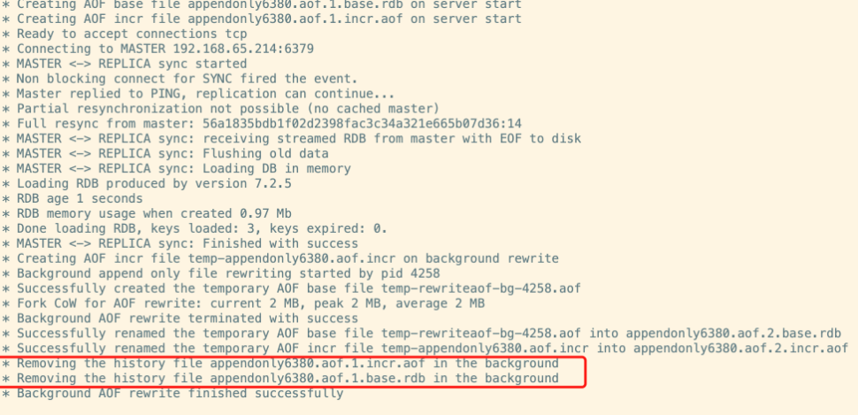

也可以在从节点尝试解除主从关系，再重新建立主从关系测试一下。 

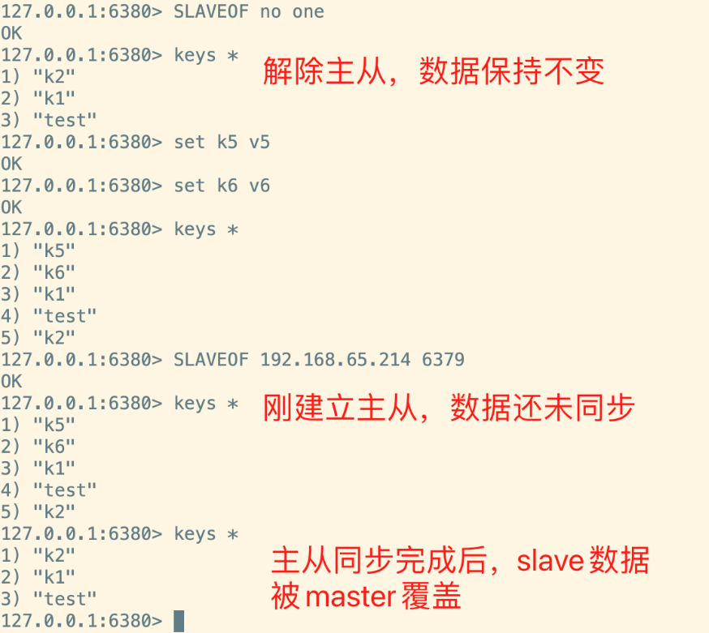

从数据安全角度重新理解主从复制：

- **数据冗余（热备份）**：master 数据实时异步同步到 slave，是持久化之外的第二种数据冗余方式；
- **容灾恢复**：master 故障时可由 slave 提供读服务，实现快速故障恢复；
- **从库只读**：默认 `replica-read-only yes`，从库禁止写操作，避免数据不一致：

```shell
127.0.0.1:6380> set k4 v4
(error) READONLY You can't write against a read only replica.
```

- **危险指令屏蔽**：从库虽然禁止写数据，但**并没有禁止 CONFIG、DEBUG 等管理指令**，这些指令若与主节点不一致，仍容易造成数据不一致。安全起见可用 `rename-command` 屏蔽危险指令：

```ini
# redis.conf 中屏蔽 CONFIG 指令（空字符串表示禁用）
rename-command CONFIG ""
# 很多企业维护 Redis 时，会直接 rename 禁用 KEYS、FLUSHDB、FLUSHALL 等危险指令
```

**主从同步流程：**

1. slave 启动后向 master 发送 sync 请求，等待建立成功后，slave 删除自己的数据日志文件，等待主节点同步；
2. master 收到请求后触发一次 **RDB 全量备份**，同时收集期间接收到的写指令，将 RDB + 指令全量同步给 slave，完成首次全量同步；
3. 主从关系建立后，master 定期向 slave 发送心跳包确认状态（`repl-ping-replica-period`，默认 10 秒）；
4. slave 定期回复心跳，master 持续将后续写指令增量传递给 slave，并记录 offset（已同步给 slave 的消息偏移量）；
5. slave 短暂失联时 master 停止同步；slave 重新上线后，master 从 offset 处继续增量同步。

**主从同步缺点：**

- **复制延迟**：所有写操作先在 master 执行再异步同步，系统繁忙或 slave 数量增加时延迟更严重；
- **master 高可用问题**：master 挂了不会自动重选，只能人工干预（这正是哨兵要解决的问题）；
- 从数据安全角度：主从复制**牺牲了服务高可用，但增加了数据安全**。

### 6.4 哨兵集群：自动故障转移（数据安全②）

> 部署细节见 2.4 节。Sentinel 不负责数据读写，专门为主从复制提供高可用能力，主要作用有四个：**主从监控、消息通知、故障转移、配置中心**。

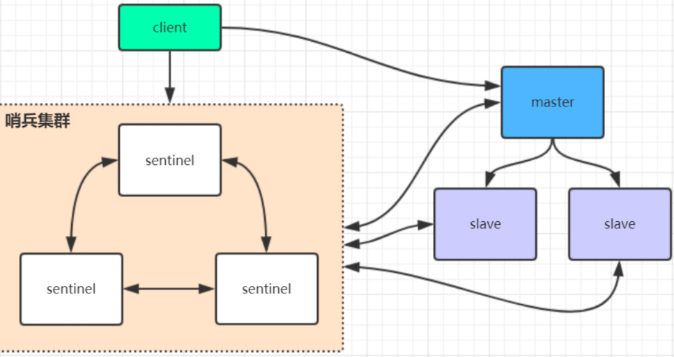

Redis的Sentinel不负责数据读写，主要就是给Redis的Replica主从复制提供高可用功能。主要作用有四个：

- 主从监控：监控主从Redis运行是否正常
- 消息通知：将故障转移的结果发送给客户端
- 故障转移：如果master异常，则会进行主从切换。将其中一个slave切换成为master。
- 配置中心：客户端通过连接哨兵可以获取当前Redis服务的master地址。

从数据安全角度重新理解哨兵：

**1）如何发现 master 宕机 —— S_DOWN 与 O_DOWN**

- **主观下线 S_DOWN**：单个 sentinel 在 `down-after-milliseconds`（默认 30 秒）内未收到 master 心跳响应，主观认为 master 下线；
- **客观下线 O_DOWN**：为防止网络抖动造成误判，sentinel 之间互相沟通，当超过 **quorum** 个 sentinel 都认为 master 已 S_DOWN 后，才真正判定 master 宕机，开始故障转移；
- 因此建议 sentinel 部署**奇数个**节点、quorum 配置为**过半数**，最大化集群可用性。

**2）发现宕机后如何切换 —— Raft 选举 + 从节点筛选**

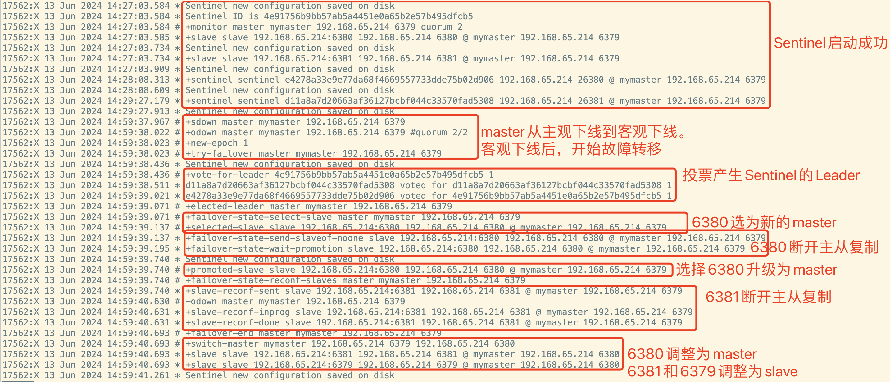

1. master 变成 O_DOWN 后，sentinel 集群基于 **Raft 算法**选举一个 Leader 协调切换（超过半数节点同意即通过——这也是 quorum 要设过半数的原因）；
2. 在健康 slave 中选出新 master，规则依次为：`replica-priority` 优先级最低（默认 100）→ 复制偏移量 offset 最大（数据最全）→ RunID 字典序最小；
3. Leader 给新 master 执行 `slaveof no one` 提升为主节点，并通知其他 slave 指向新 master；
4. 旧 master 恢复后自动降级为 slave，从新 master 同步数据，恢复工作。

**数据安全弱点：** 在主从复制集群中，无论 master 是谁，所有数据都以 master 为准。**master 宕机时，那些已完成但尚未同步给 slave 的写操作会彻底丢失**——切换完成后，所有数据以新 master 为准。因此企业实际应用中，用得更多的是下面的 Redis 集群。

### 6.5 Redis 集群：分片 + 高可用（数据安全③）

> 部署细节见 2.5 节。一句话总结：**将多组 Redis 主从复制集整合到一起，像一个 Redis 服务一样对外提供服务**。Cluster 的核心依然是 Replica 复制集。

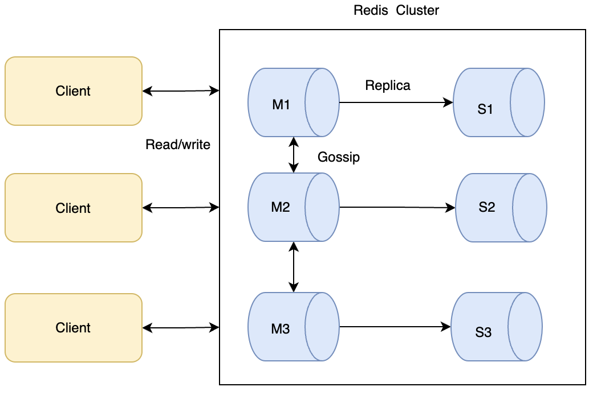

**集群要解决的三个核心问题：**

1. 客户端需要频繁切换 master 的问题；
2. 服务端数据量太大、单个复制集难以承担的问题；
3. master 挂了之后，主动将 slave 切换成 master、保证服务稳定。

#### 7.5.1 Slot 槽位与数据分布

- 集群内置 **16384 个哈希槽**，每个 key 通过 `CRC16(key) mod 16384` 决定所属槽位，每个节点负责部分槽位；
- **数据迁移**：集群节点增减时需要触发 `reshard` 重新分配槽位，且只需迁移对应槽位的数据；
- **完整覆盖**：如果负责某段槽位的一组复制节点全部挂掉，默认整个集群停止服务（`cluster-require-full-coverage yes`）；强行设为 `no` 可让剩余节点继续服务，但意味着数据服务不完整，**通常不建议**；
- **CROSSSLOT 限制**：批量复合指令（如 `mset`）要求所有 key 在同一槽位，否则报错：

```shell
127.0.0.1:6381> mset k1 v1 k2 v2 k3 v3
(error) CROSSSLOT Keys in request don't hash to the same slot
```

> 这也是对分布式事务的一种思考：批量指令若分散到不同节点，原子性问题就升级为分布式事务问题，非常复杂；大部分业务场景下直接拒绝分布式事务，是很好的策略。

- **hashtag 强制同槽**：key 中包含 `{}` 时，只按大括号内的内容计算槽位，可让相关 key 落在同一节点：

```shell
127.0.0.1:6381> CLUSTER KEYSLOT k1
(integer) 12706
127.0.0.1:6381> CLUSTER KEYSLOT roy{k1}
(integer) 12706
127.0.0.1:6381> mset user_{1}_name roy user_{1}_id 1 user_{1}_password 123
-> Redirected to slot [9842] located at 192.168.65.214:6382
OK
```

- **数据倾斜**：大型集群常出现热点 key 集中到某一节点、导致负载明显不均的资源浪费。调整思路分两步：① 调整 key 结构，让热点 key 尽量平均分配到各个 slot；② 调整 slot 分布，把数据量大、访问频繁的热点 slot 重新调配到不同节点。

#### 7.5.2 gossip 协议与集群通信

Redis 集群节点之间通过 **gossip 协议**频繁通信，用于传递消息和更新节点状态，是去中心化的：

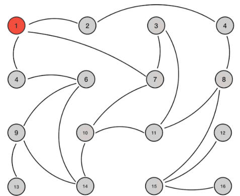

| 消息 | 作用 |
| --- | --- |
| `meet` | 让新节点加入集群，随后新节点开始与其他节点通信 |
| `ping` | 频繁发送，携带自身状态与集群元数据（节点增删、hash slot 信息等） |
| `pong` | 对 ping/meet 的应答，也可用于信息广播和更新 |
| `fail` | 某节点判断另一节点宕机后广播通知其他节点 |

- gossip 协议更新元数据**不是同时同步**，而是陆续传播到所有节点，因此数据统一**有一定延迟**；
- 好处：节点增多时每个节点的负载增加很少（几乎恒定），适合构建较大集群；但数据同步延迟也会随节点增多而增加，对 Redis 不合适，**不建议构建太大的集群**；
- 每个节点还有一个 `服务端口 + 10000` 的专用端口用于 gossip 通信，**部署集群时注意防火墙不要屏蔽该端口**。

#### 7.5.3 集群选举原理

当 slave 发现自己的 master 变为 FAIL 状态时，会尝试 Failover 竞选新 master。由于挂掉的 master 可能有多个 slave，存在多个 slave 竞争的过程：

1. slave 发现 master 变为 FAIL；
2. 将自己记录的 currentEpoch 加 1，广播 `FAILOVER_AUTH_REQUEST`（currentEpoch 即选举周期，可通过 `cluster info` 查看）；
3. 其他节点收到后**只有 master 响应**，判断请求者合法性并发送 `FAILOVER_AUTH_ACK`（每个 epoch 只发一次 ack）；
4. 竞选 slave 收集各 master 返回的 ack；
5. **收到超过半数 master 的 ack 后成为新 master**——这就是集群为什么至少需要 3 个主节点：如果只有 2 个主节点，其中一个挂了，剩余 1 个主节点无法凑够半数，选举失败；
6. slave 广播 Pong 消息通知其他集群节点。

从节点并不是一发现 FAIL 就立刻发起选举，而是延迟一段时间，确保 FAIL 状态已在集群中传播（否则其他 master 可能尚未意识到 FAIL、拒绝投票）：

```text
DELAY = 500ms + random(0 ~ 500ms) + SLAVE_RANK * 1000ms
```

其中 `SLAVE_RANK` 表示该 slave 已从 master 复制的数据量排名，**Rank 越小代表已复制的数据越新**，理论上持有最新数据的 slave 会最先发起选举。

#### 7.5.4 集群能否保证数据安全？

**相对稳定运行时，Redis 集群可以保证数据安全**：每个 master 都可配置 slave 从节点实时备份，master 宕机时 slave 自动切换成 master 继续提供服务。

还可以用两个参数强制保证每个 master 必须有健康的 slave：

```ini
# 至少连接 N 个副本、且延迟不超过 M 秒时，master 才接受写入（默认关闭）
min-replicas-to-write 3
min-replicas-max-lag 10
```

但**不保证强一致性**：由于 gossip 协议同步元数据时不保证强一致，在特定的苛刻条件下（概率较小），如网络抖动产生的**脑裂**问题，集群可能会丢失少量已被系统收到的写请求。

> 在企业中有良好运维支持时，通常可以认为 Redis 集群的数据是安全的。

### 6.6 数据安全性方案总结

从数据安全角度梳理 Redis 从单机到集群的部署架构：

| 方案 | 数据冗余 | 自动故障转移 | 数据分片 | 数据安全定位 |
| --- | --- | --- | --- | --- |
| 单机 + 持久化 | ❌ | ❌ | ❌ | 保证单机数据不丢；磁盘损坏则无解 |
| 主从复制 | ✅ 热备份 | ❌ 需人工 | ❌ | 数据冗余 + 容灾，牺牲高可用换数据安全 |
| 哨兵集群 | ✅ | ✅ | ❌ | 自动故障转移；未同步数据可能丢失 |
| Redis 集群 | ✅ 每主带从 | ✅ | ✅ 16384 槽 | 分片 + 高可用；特殊条件下可能丢少量写请求 |

**总结：**

1. 持久化是数据安全的地基，**RDB 定期备份 + AOF 实时追加（混合持久化）**是最佳组合；
2. 分布式架构层层递进：主从解决数据冗余 → 哨兵解决自动故障转移 → 集群解决容量与稳定性，每一层都从不同角度提升数据安全；
3. Redis 的数据保存策略在很多场景下堪称"教科书级"解决方案；企业版（Redis Enterprise）在业务功能层面并未做太多加法，核心就是**服务高可用与数据安全**方面的全面增强；
4. 不过基于内存与硬盘的成本对比，**Redis 通常仍不建议作为独立数据库使用**，大部分场景还是发挥高性能优势作为缓存；如果有非常靠谱的运维支撑，Redis 作为数据库（如 Redis Cloud 实例）也完全可行。

## 9. Redisson

Redisson 是架设在 Redis 之上的 Java 驻内存数据网格（In-Memory Data Grid），提供了比 RedisTemplate 更丰富的分布式能力：**分布式锁**（可重入锁、公平锁、读写锁、RedLock）、分布式集合（Map/Set/Queue）、限流器（RRateLimiter）、延迟队列、布隆过滤器、分布式对象等。最常用的场景是**分布式锁**——内置看门狗（Watchdog）机制，在锁即将到期且业务未执行完时自动续期，避免锁提前过期。

引入依赖：

```xml
<!-- Redisson -->
<dependency>
    <groupId>org.redisson</groupId>
    <artifactId>redisson-spring-boot-starter</artifactId>
    <version>3.24.3</version>
</dependency>
```

增加配置：

```yaml
spring:
  redis:
    redisson:
      config: |
        singleServerConfig:
          idleConnectionTimeout: 10000
          connectTimeout: 10000
          timeout: 3000
          retryAttempts: 3
          retryInterval: 1500
          password: '<密码>'
          subscriptionsPerConnection: 5
          clientName: null
          address: "redis://r-xxxx.redis.rds.aliyuncs.com:6379"
          subscriptionConnectionMinimumIdleSize: 1
          subscriptionConnectionPoolSize: 50
          connectionMinimumIdleSize: 24
          connectionPoolSize: 64
          database: 0
          dnsMonitoringInterval: 5000
        threads: 16
        nettyThreads: 32
        codec: !<org.redisson.codec.JsonJacksonCodec> {}
        transportMode: "NIO"
```

## 10. 参考资料

- [Redis 官方网站](https://redis.io/)
- [Redis 官方命令文档](https://redis.io/docs/latest/commands/)
- [Redis 中文网](https://www.redis.net.cn/)
- [Redis Windows 版下载（tporadowski 维护，推荐）](https://github.com/tporadowski/redis/releases/)
- [Redis Windows 旧版下载（microsoftarchive 归档）](https://github.com/microsoftarchive/redis/releases)
- [DB-Engines 数据库流行度排名](https://db-engines.com/en/)
- [Redis 教程博客（刘清政）](https://www.cnblogs.com/liuqingzheng/p/9831331.html)
